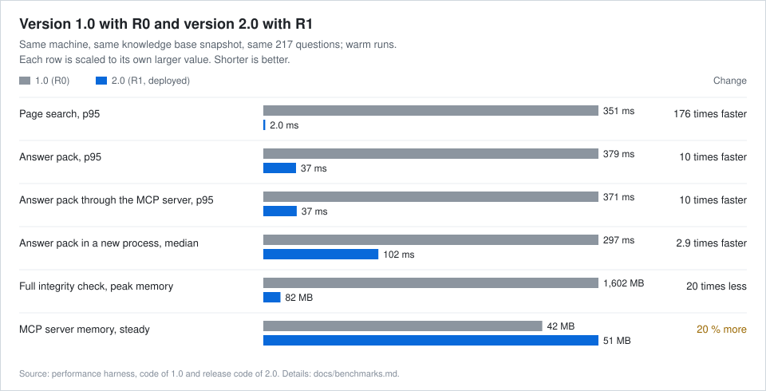
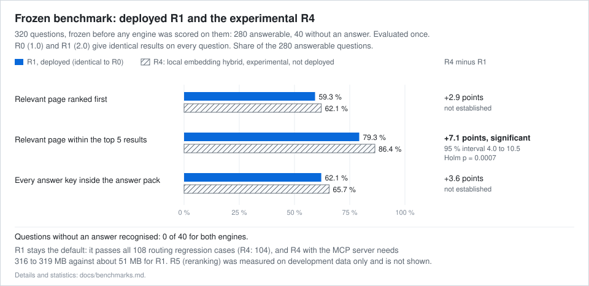

# LEKS: Local Engineering Knowledge System

A local system for organizing, searching and checking engineering knowledge across project documentation, Unity, Blender and AI development workflows.

I built it for a long-running engineering project where a small team works together with AI coding agents.
- **One folder for everything.** What the project knows lives in one folder: Markdown pages for decisions, deliveries and designs, plus the registered source files they're based on. LEKS keeps that folder consistent and makes every source file recoverable.
- **Two interfaces.** AI coding agents get short, cited answer packs through a local MCP server (Model Context Protocol). People read and edit the same pages in Obsidian, which also shows how they link together.

**The engine's code is public** in [`engine/`](engine/): the search, the evidence store, the claims and the MCP server, without any project data. Its 124 tests run on GitHub's macOS machines on every change:

[](https://github.com/jacobemanuel/leks/actions/workflows/engine-tests.yml)

This page is about **LEKS 2.0**, the current version. Version **1.0** was published earlier under the title "Engineering knowledge base", and [its README is archived](docs/history/README-1.0.md) in this repository. Version 2.0 returns the same search results as 1.0 and rebuilds what sits underneath: indexing, evidence storage, recovery and checks.

Below I compare 2.0 with 1.0. Then I compare the default search engine with an experimental local AI engine I tested but didn't ship.

## What runs where

- **LEKS runs on the developer's Mac.**
  - Build, checks, search, answer packs, the MCP server, the hooks and the evidence store are all Python programs. They use only the standard library and talk to the agent over stdio.
  - A static check in the test suite scans their source and finds no import of a networking module. It only checks the code and doesn't cover what the programs do at run time.
- **The experimental engines R4 and R5 are optional.**
  - They run in a separate process (the model helper) inside a macOS sandbox with no network access. A probe shows that TCP connections are refused inside the sandbox, even to the local machine, and succeed outside it.
  - Their installer downloads pinned packages and model files once at install time.
- **Obsidian, Unity, Blender and the code editor** are separate programs with their own network behaviour. LEKS doesn't control or check it.
- **AI coding agents** get answer packs from the MCP server when they ask for them. What an agent then does with that text depends on the agent and how it's configured. That includes whether its model runs locally or in the cloud.

## Architecture


| Layer | What it does | Added in |
|---|---|---|
| Source registry | SHA-256, size, origin, former paths and revisions of every source file (2,850). IDs survive moves and renames. | 1.0 |
| Evidence store | Exact, hash-addressed copies of every registered source file, kept outside the knowledge base. Restore by ID, path or hash. | 2.0 |
| Journal and incidents | A hash-chained log of evidence events. Damage opens an incident that stays visible until a person resolves it. | 2.0 |
| File-system protection | The user-immutable flag on every registered source file, re-applied and reported at every agent session start | 2.0, on by default |
| Pages and claims | Compiled Markdown pages, and claims with confidence (verified, reported, inferred, planned, unknown), scope and evidence date | 1.0 |
| Evidence anchors | Each active claim cites a line range and the hash of the excerpt it rests on. | 2.0 |
| Typed facts and time | Typed facts with valid time and record time, plus contradiction checks and freshness rules | 2.0 |
| Search index (R1) | A persistent in-memory BM25 index with R0's ranking rules, updated page by page | 2.0 |
| Answer pack | Passages of the four best pages, their claims, the next pages to read, and a note that the passages are not a confirmed answer | 1.0, extended in 2.0 |
| MCP server | Nine read-only tools over stdio | 1.0 |
| Hooks and checks | Session-start hook, pre-tool check of agent actions and stop check, plus `doctor` and `setup` | 1.0, extended in 2.0 |

More in [architecture](docs/architecture.md).

## Search engines: R0, R1, R4, R5

| Engine | What it is | Status |
|---|---|---|
| **R0** | The engine of 1.0. It reads and tokenizes every page for each query, then ranks with BM25 and hand-written rules. | Replaced by R1, kept as the reference |
| **R1** | The engine of 2.0: R0's scoring, served from a persistent index | **Deployed** (default) |
| **R4** | Experimental hybrid: R1's lexical ranking fused with a small local embedding model (`bge-small-en-v1.5`, ONNX Runtime on the CPU, in the sandboxed model helper) | Evaluated on the frozen benchmark, not deployed |
| **R5** | Experimental reranking: a small local cross-encoder reorders R4's top 20 results | Development set only, not deployed |

The numbers come from the evaluation protocol. It was fixed before any engine was built. R2 is the embedding model on its own (one half of R4) and was measured only on the development set. There's no R3 in the protocol. "Top 5" in the tables and charts means the relevant page is among the first five search results. It's a measure and has nothing to do with R5.

## Version 2.0 compared with 1.0

### What changed

| Area | 1.0 | 2.0 |
|---|---|---|
| Search | R0 reads all pages again for every query. | R1 keeps a persistent index, updates only the pages that changed and returns identical rankings. |
| Evidence tracking | A registry with hashes. Claims cite whole files. | Claims cite hashed excerpts, so a changed, missing or superseded source file shows up at claim level. |
| Verification | The full integrity check hashes every source file, but the stop check could miss an in-place edit of an existing one. | The stop check compares every source file's size and time stamps, so in-place edits are caught. Damage opens a persistent incident. |
| Recovery | Hashes caught changes, but there was no copy of the original bytes. | An evidence store with exact copies. A restore brings back the original bytes and keeps the damaged ones for inspection. |
| Data protection | Files were writable. Protection relied on the agent rules and the pre-tool check. | File-system immutable flags on every source file, and atomic writes under a lock for the registry and the claims |
| History and facts | Claims with an evidence date and supersession | Typed facts with valid and record time, "as of" queries, and contradiction and freshness checks |
| Local semantic AI | On-device embeddings tested, not adopted | R4 and R5 built and measured as opt-in experiments. R1 stays the default. |

### Same results, by design

R1 gives exactly the same rankings as R0:
- I checked this on all 941 questions of the development and benchmark sets, including the 177 questions of the 1.0 benchmark.
- It also holds on every item of the frozen benchmark. The answer packs come out the same there too.

So the speed-up changes nothing about what gets retrieved. The only visible difference is in the answer pack. In 2.0 it names its engine and carries a fixed note saying its passages are only the closest matches and may not answer the question. That makes packs about 2 % longer. Re-running the development evaluation with these additions didn't change any ranking, coverage or verdict.

### Performance: same machine, same knowledge base, same questions



Both versions were measured with the same performance harness, on the same 217 questions and the same snapshot of the knowledge base (91 pages, 2,850 source files). Same Mac for both, running Python 3.9.6. Runs are warm, after one discarded run. The figures are 95th percentiles unless stated otherwise.

| Measure | 1.0 (R0) | 2.0 (R1) | Change |
|---|---:|---:|---|
| Page search, p95 | 351 ms | 2.0 ms | 176 times faster |
| Answer pack, p95 | 379 ms | 37 ms | 10 times faster |
| Answer pack through the MCP server, p95 | 371 ms | 37 ms | 10 times faster |
| Answer pack in a new process, median | 297 ms | 102 ms | 2.9 times faster |
| Full integrity check: time / peak memory | 8.2 s / 1,602 MB | 7.7 s / 82 MB | 20 times less memory |
| Fast integrity check: time / peak memory | 1.1 s / 50 MB | 1.5 s / 57 MB | slower, because it checks more |
| MCP server memory, steady | 42 MB | 51 MB | 20 % higher |
| Answer pack size, median | about 2,800 tokens | about 2,860 tokens | 2 % longer (engine field and fixed note) |
| Context loaded at session start | about 2,500 tokens | about 2,500 tokens | unchanged |

Token figures are estimates of everything returned (characters divided by 4). The "1,800-token pack" in the 1.0 documentation is really the budget for page passages. Claims, next pages and status fields come on top of it.

An independent reviewer also ran both engines in one process on a different set of 20 routing questions. That gave 173 ms for R0 against 2.3 ms for R1 at p95, about 74 times faster. The two runs agree on the order of magnitude but not on the exact factor. The [methodology](docs/benchmarks.md#performance-measurements) lists every performance figure with its conditions.

### The 1.0 benchmark

For 1.0, six independent agents wrote 177 questions and the set was frozen before the first run.
- **Result:** the 1.0 answer pack (built from the four best pages) held every answer key for 70.6 % of them. A pack with only the best page got 57.1 %.
- **Paired test:** 24 questions gained and none lost (exact McNemar p < 0.0001).

On the same 177 questions, R1 puts the relevant page first for 51.4 % and in the top 5 for 75.7 %. A later re-run of 1.0 gave the same figures. R0 and R1 ranked every tested question identically. Pack coverage on this set wasn't re-measured for 2.0.

This benchmark and the frozen one below use different questions and answer keys. So their percentages can't be compared.

## Deployed R1 compared with experimental R4



The frozen benchmark has 320 questions, written by eight separate agent sessions. There are 150 direct questions, 80 paraphrased ones, 50 that need several sources and 40 that the knowledge base can't answer. They were validated and frozen before any engine was scored on them. The benchmark was evaluated once, with the analysis fixed in advance.

| Measure (280 answerable questions) | R0 and R1 (deployed) | R4 (experimental) | Difference, percentage points |
|---|---:|---:|---|
| Relevant page ranked first | 59.3 % | 62.1 % | +2.9, not established |
| Relevant page within the top 5 results | 79.3 % | 86.4 % | +7.1 (95 % interval 4.0 to 10.5, Holm p = 0.0007) |
| Every answer key inside the answer pack | 62.1 % | 65.7 % | +3.6, not established |
| Questions without an answer recognised (of 40) | 0 | 0 | none |

Most of R4's gain comes from paraphrased questions, where it gets 63.8 % in the top 5 against 43.8 % for R1.

**Why R1 stays the default:**
- **Regression test:** R1 passes all 108 hand-written cases of the routing regression test, which its ranking rules were tuned on. R4 passes 104.
- **Memory and footprint:** with the MCP server, R4 needs 316 to 319 MB against about 51 MB for R1. R4 also brings an embedding model, the model helper process and about 3 seconds of start-up.

Neither engine recognises questions the knowledge base can't answer. That's why every pack tells the agent that its passages aren't a confirmed answer.

R5 did even better on the development set. But it costs 0.5 to 1 s per query and was never run on the frozen benchmark, so it isn't shown here. More in [benchmarks and methodology](docs/benchmarks.md).

## Efficiency

| What | Result | Kind |
|---|---|---|
| Search and answer packs | 2.9 to 176 times faster than version 1.0, with identical rankings | measured |
| Memory of the full integrity check | 1,602 MB → 82 MB | measured |
| Index updates | After one page changes, the next search takes 0.014 s at 91 pages and 0.077 s at 10,027 pages (91 real, the rest synthetic) | measured |
| Scaling | At 10,027 pages, R1 search p95 is 68 ms on 100 queries. R0 took about 22 s per query there. But only 3 queries were timed, so treat the 22 s as a rough figure. | measured, with [limits](docs/efficiency.md#measurement-limits) |
| Context per question | Answer pack about 2,800 tokens in version 1.0 and 2,860 in version 2.0 (engine field and fixed note). Session start about 2,500 in both | measured (characters / 4) |
| Agent steps per question | 3.40 with the engine that R0 replaced and no answer pack, 2.31 with R0 and the 1.0 answer pack | modelled, 1.0 only |
| Fewer agent steps, tokens or cost in 2.0 | Not claimed. The step model wasn't re-run for 2.0 and no agent sessions were measured. Version 2.0 makes the local work faster. The agent still reads about the same amount of context. | not verified |

More in [efficiency](docs/efficiency.md).

## Known limitations

- **Retrieval quality is the same as in 1.0.** R1 is faster and returns exactly the same rankings. Paraphrased questions are still the weak spot, with 43.8 % in the top 5.
- **Unanswerable questions aren't recognised.** None of the 40 was. Instead every pack says its passages aren't a confirmed answer.
- **Distractors hurt.** Adding 10,000 synthetic pages built from real sentences drops top 5 on the development set from 77.9 % to 36.5 %.
- **Typed facts cover only part of the knowledge.** Many claims are still prose with sources rather than typed facts.
- **Protection has limits:**
  - The immutable flags stop accidental writes. But any process running as the same user can remove them on purpose.
  - The pre-tool check is a heuristic and can't be relied on as a security boundary.
  - Network access is checked statically for the LEKS tools and with a probe for the model helper. The other applications aren't checked.
  - The evidence store sits on the same disk, so an off-disk backup is still needed.
- **The question authors are AI agents.** Their independence is procedural and the answer keys reflect their choices.

The full list is in [known limitations](docs/limitations.md).

## Running the engine

From the `engine/` folder, this command runs the tests:

```bash
python3 -m unittest discover -s tools -p 'test_*.py'
```

Where Python has no `os.chflags`, as on Linux, the six tests that need the immutable flag are skipped.

The MCP server is `tools/vault_mcp.py`. It takes no arguments, serves the folder above `tools/` as the knowledge base and speaks JSON-RPC 2.0 over stdio, one message per line. In this repository that folder is `engine/`, which holds no project data, so a search there returns nothing. From the knowledge base folder, this command starts the server, which then waits for requests on standard input:

```bash
python3 tools/vault_mcp.py
```

MCP clients start the server themselves. In Claude Code, for example, this command registers it under the name `xr-vault`, with the full path to `vault_mcp.py`:

```bash
claude mcp add xr-vault -- python3 /path/to/knowledge-base/tools/vault_mcp.py
```

## Documentation

- [Architecture](docs/architecture.md)
- [Benchmarks and methodology](docs/benchmarks.md)
- [Efficiency](docs/efficiency.md)
- [Security and recovery](docs/security.md)
- [Known limitations](docs/limitations.md)
- [Version history](docs/version-history.md)
- [README of version 1.0, archived](docs/history/README-1.0.md)

## Notes

- The engine's code is in [`engine/`](engine/). The project's content and the benchmark questions aren't in this repository.
- The figures describe only the tooling. Project names are left out.

The code in [`engine/`](engine/) is under the [MIT licence](LICENSE). Text and media: © 2026 Jakub Majewski, all rights reserved.
