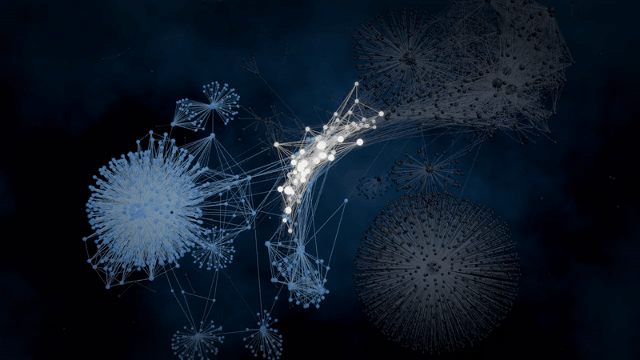
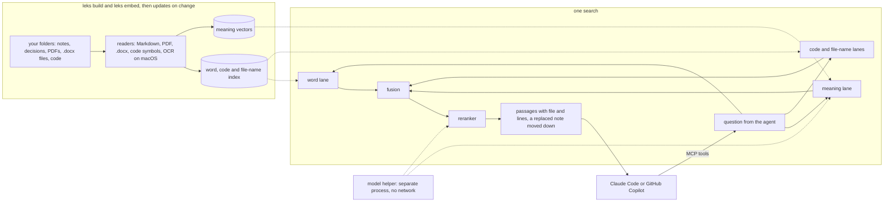
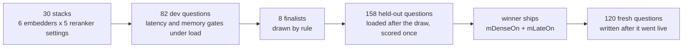
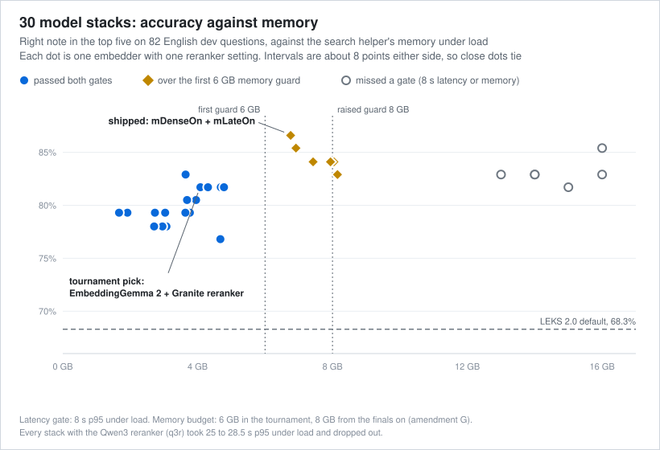
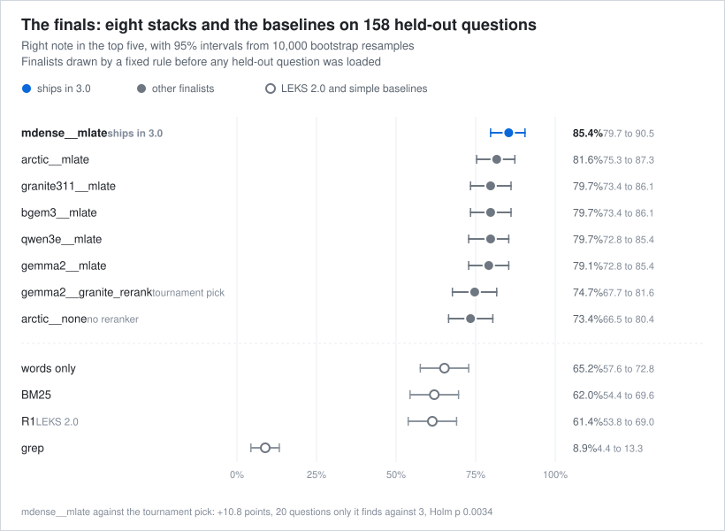
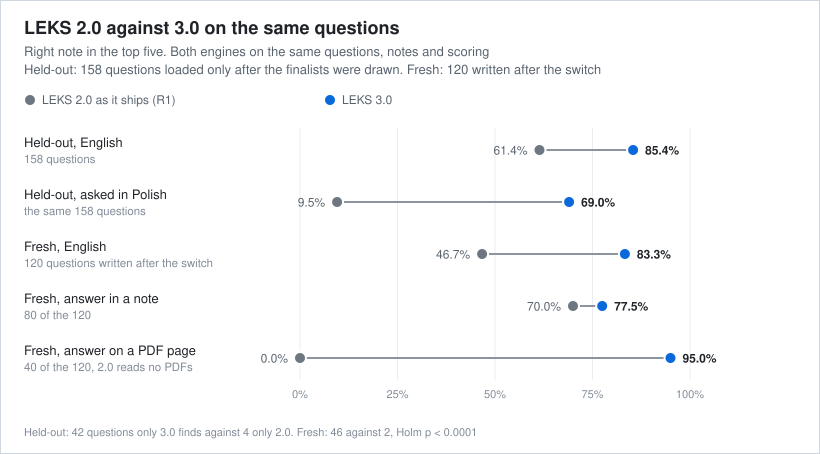
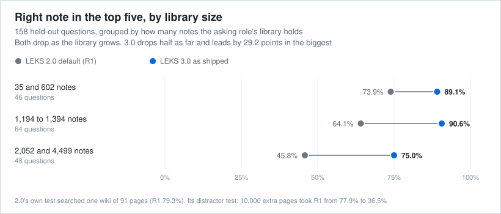
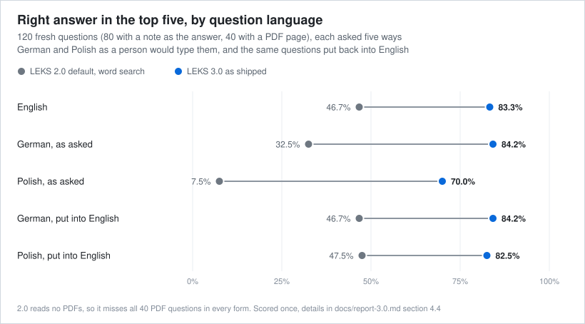
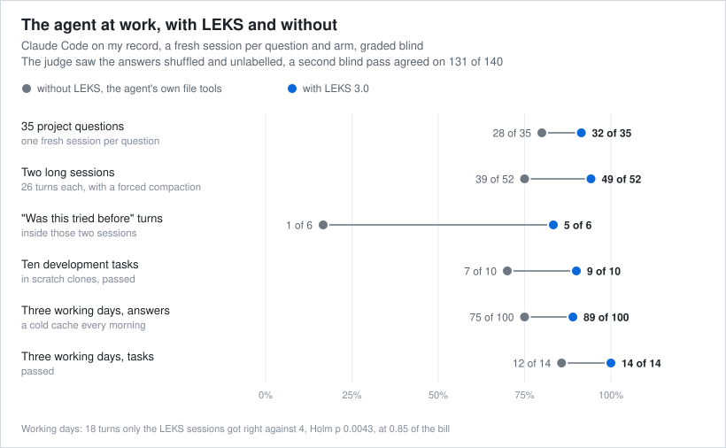
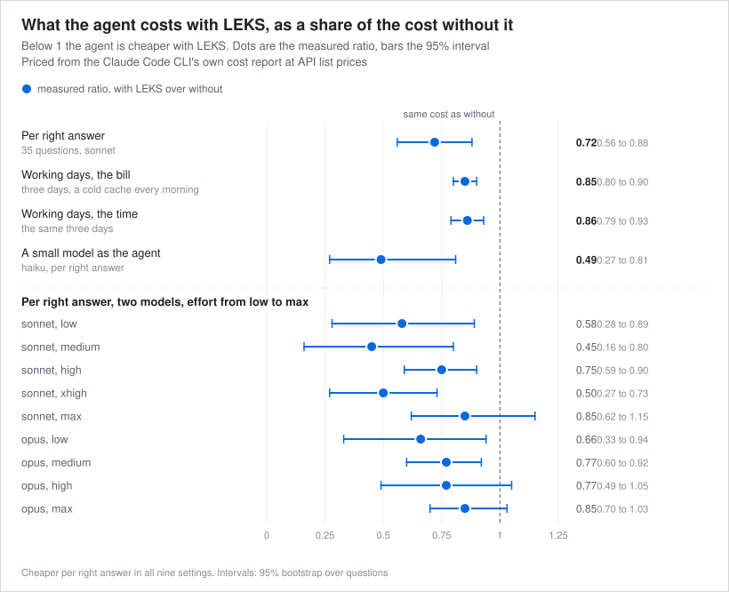

# LEKS

[](https://github.com/jacobemanuel/leks/actions/workflows/tests.yml)


[](https://majewski.studio/assets/work/leks-graph.mp4)

Local search for coding agents. Your agent asks a question and LEKS hands back the passages that answer it, from your own notes, decisions, PDFs, `.docx` files and code, each with its file and line range so the agent can cite it. The index and the models run on your machine.

I built LEKS for my own research knowledge base, a real and private record I have worked in every day since February 2026: notes, decisions, papers and code of an ongoing research project, 7,294 documents and 172,775 files. Every number below comes from that record. Version 3.0 searches by words and by meaning, reranks with a small local model, reads PDFs and `.docx` files, and knows when a newer note replaces an older one. Its models won a tournament of 30 model stacks played under rules I fixed and hashed in advance, and the winner then beat 2.0 again on fresh questions written after it went live. The full report with every table is in [docs/report-3.0.md](docs/report-3.0.md).

## At a glance

- **Finds the right note far more often.** 158 held-out questions that no tuning had seen: 85.4% in the top 5 against 61.4% for 2.0. 42 of them only 3.0 finds, 4 only 2.0 finds
- **Holds on fresh questions.** 120 questions written after 3.0 went live, from documents drawn at random: 83.3% against 46.7%, 46 questions against 2, Holm p < 0.0001
- **Reads PDFs.** 95.0% in the top 5 when the answer sits on a PDF page. 2.0 reads none
- **Understands German and Polish.** Asked in German 84.2% (2.0: 32.5%), in Polish 70.0% (2.0: 7.5%)
- **Makes the agent better and cheaper.** Three scripted working days of questions and dev tasks in one conversation: 89 of 100 answers right with LEKS against 75 of 100 without (Holm p 0.0043), 14 of 14 tasks passed against 12 of 14, at 0.85 of the bill
- **Scales to a real record.** 7,294 documents (4.6 GB of text, 380,564 passages) in full and 172,775 files (249 GB) by name, where 2.0's own test searched 91 wiki pages
- **Stays local.** The models run in a separate helper process, on macOS in a sandbox with no network

## What it searches

| | LEKS 2.0 | LEKS 3.0 |
|---|---|---|
| full text | Markdown pages. Its own release test ran on one wiki of 91 pages built from 2,850 source files | Markdown, PDF, `.docx` and code. In my record 7,294 documents, 4.6 GB, 380,564 passages at test time |
| PDFs | no | 446 PDFs (4.4 GB) in my record, scanned pages through OCR on macOS |
| code | no | symbols from Python, Swift and more, 1,357 Python and 524 Swift files in my record |
| by file name and path | no | 172,775 files, 249 GB in my record |
| what an answer is | a whole page | a passage with its file and lines, or its page, slide or symbol |

The record and its questions stay private. The tables, the statistics and the harness are public here, and `bench/` runs the same kind of measurement on a synthetic corpus that ships with the repo.

[](https://majewski.studio/assets/work/leks-graph.mp4)

## How it works



The agent gets six tools over MCP:

- `search` finds the passages for a question
- `read` opens the cited lines or pages
- `locate` finds files and definitions by name
- `tried` says whether a proposal was tried before and what happened then
- `state` lists the notes that say where the project stands now
- `status` shows the index size, the models and which lanes are on

Every search answer says which lanes ran, so if the models are off you see it right there. The details are in [docs/how-it-works.md](docs/how-it-works.md).

## Why models at all

2.0 was pure word search. Its default engine R1 ranks whole pages by words (BM25 with title weighting, a domain thesaurus and hand-written rules). It's tiny (about 51 MB), fast (2.0 ms p95 in its own test) and works great as long as you use the same words as your notes. With other words its recall drops: 43.8% top 5 on paraphrased questions in its own test, 9.5% on Polish questions here.

2.0 already had two model engines on the side. R4 (words plus a small embedding model) won +7.1 points on 2.0's own test, but it needed six times the memory and failed 4 of the 108 routing cases R1 passes, so it stayed off. R5 (R4 plus a reranker) did even better on the dev set at 0.5 to 1 s per query. In the 3.0 tournament I rebuilt both shapes on the new dev set: R4-like got 73.2% and R5-like 75.6%, against 68.3% for R1 and 86.6% for the best stack. So 3.0 takes R5's shape, words plus meaning plus a reranker, and a tournament picks the models.

## How 3.0 picked its models



**Round 1, the tournament.** 6 embedding models times 5 reranker settings (4 rerankers and none) is 30 stacks, all small open models that run locally. Every stack ran inside the same hybrid search on the same 82 frozen English dev questions, the same snapshot of the record and the same scoring, with two gates under load (four CPU busy loops and a second search running beside it): 8 s p95 per search, and a memory budget for the helper that holds both models. At the 6 GB budget of round 1, 18 stacks passed both gates. The fixed choice rule then picked EmbeddingGemma 2 with the Granite reranker (81.7%): it ties with the top of the passing stacks and wins the tie-breaks on MRR and speed. The mLateOn reranker took the top score and five of the six best places, all inside the latency gate, at 6.9 to 8.3 GB of memory. The six stacks with the Qwen3 reranker took 25 to 28.5 s p95 under load and dropped out.



<details open>
<summary>All 30 stacks on dev, sorted by English top 5</summary>

82 counted questions per form. Status: within both gates at 6 GB, over the 6 GB memory budget, or over the 8 s latency gate.

| stack | EN top 5 (95% CI) | EN top 1 | EN MRR | PL as written, top 5 | p95 under load | memory under load, MB | status |
|---|---|---|---|---|---|---|---|
| **mdense__mlate**, ships | **86.6** (79.3 to 93.9) | 62.2 | 0.718 | 72.0 | 4.6 s | 6,921 | over 6 GB |
| arctic__q3r | 85.4 (76.8 to 92.7) | 48.8 | 0.627 | 70.7 | 28.3 s | 16,384 | over 8 s |
| gemma2__mlate | 85.4 (76.8 to 92.7) | 62.2 | 0.717 | 78.0 | 4.5 s | 7,083 | over 6 GB |
| arctic__mlate | 84.1 (75.6 to 91.5) | 63.4 | 0.725 | 72.0 | 4.4 s | 8,237 | over 6 GB |
| granite311__mlate | 84.1 (75.6 to 91.5) | 63.4 | 0.729 | 65.9 | 4.8 s | 7,603 | over 6 GB |
| qwen3e__mlate | 84.1 (75.6 to 91.5) | 58.5 | 0.701 | 73.2 | 4.8 s | 8,132 | over 6 GB |
| arctic__none | 82.9 (74.4 to 90.2) | 51.2 | 0.639 | 63.4 | 0.7 s | 3,730 | within |
| bgem3__mlate | 82.9 (74.4 to 90.2) | 61.0 | 0.711 | 70.7 | 4.4 s | 8,345 | over 6 GB |
| bgem3__q3r | 82.9 (74.4 to 90.2) | 51.2 | 0.633 | 70.7 | 25.0 s | 13,312 | over 8 s |
| granite311__q3r | 82.9 (74.4 to 90.2) | 47.6 | 0.619 | 65.9 | 28.5 s | 14,336 | over 8 s |
| mdense__q3r | 82.9 (74.4 to 90.2) | 50.0 | 0.625 | 63.4 | 28.5 s | 14,336 | over 8 s |
| qwen3e__q3r | 82.9 (74.4 to 90.2) | 47.6 | 0.612 | 69.5 | 28.3 s | 16,384 | over 8 s |
| arctic__granite_rerank | 81.7 (73.2 to 90.2) | 59.8 | 0.690 | 57.3 | 3.4 s | 4,800 | within |
| bgem3__granite_rerank | 81.7 (73.2 to 89.0) | 61.0 | 0.698 | 54.9 | 4.2 s | 4,897 | within |
| **gemma2__granite_rerank**, tournament pick | **81.7** (73.2 to 90.2) | 61.0 | 0.703 | 58.5 | 4.0 s | 4,180 | within |
| gemma2__q3r | 81.7 (73.2 to 90.2) | 47.6 | 0.609 | 72.0 | 28.4 s | 15,360 | over 8 s |
| qwen3e__granite_rerank | 81.7 (73.2 to 89.0) | 56.1 | 0.681 | 58.5 | 4.0 s | 4,410 | within |
| granite311__granite_rerank | 80.5 (72.0 to 89.0) | 57.3 | 0.681 | 61.0 | 4.4 s | 4,050 | within |
| mdense__granite_rerank | 80.5 (72.0 to 89.0) | 58.5 | 0.684 | 52.4 | 3.9 s | 3,776 | within |
| arctic__msmarco | 79.3 (69.5 to 87.8) | 51.2 | 0.639 | 46.3 | 0.6 s | 3,771 | within |
| bgem3__msmarco | 79.3 (69.5 to 87.8) | 50.0 | 0.623 | 39.0 | 0.6 s | 3,861 | within |
| bgem3__none | 79.3 (70.7 to 87.8) | 52.4 | 0.635 | 68.3 | 0.8 s | 2,799 | within |
| gemma2__none | 79.3 (70.7 to 87.8) | 54.9 | 0.658 | 67.1 | 0.6 s | 3,109 | within |
| granite311__none | 79.3 (70.7 to 87.8) | 56.1 | 0.651 | 53.7 | 0.6 s | 1,964 | within |
| mdense__none | 79.3 (70.7 to 87.8) | 56.1 | 0.670 | 53.7 | 0.5 s | 1,709 | within |
| qwen3e__none | 79.3 (70.7 to 87.8) | 53.7 | 0.642 | 64.6 | 0.6 s | 3,723 | within |
| gemma2__msmarco | 78.0 (68.3 to 86.6) | 53.7 | 0.654 | 39.0 | 0.5 s | 3,149 | within |
| granite311__msmarco | 78.0 (68.3 to 86.6) | 52.4 | 0.644 | 47.6 | 0.6 s | 3,028 | within |
| mdense__msmarco | 78.0 (68.3 to 86.6) | 52.4 | 0.645 | 37.8 | 0.5 s | 2,774 | within |
| qwen3e__msmarco | 76.8 (67.1 to 85.4) | 51.2 | 0.631 | 42.7 | 0.5 s | 4,786 | within |

The baselines on the same dev questions: R5-like 75.6, words only 75.6, BM25 74.4, R4-like 73.2, R1 68.3, grep 9.8. Rerankers help most on Polish as written, where R1 reads 9.8.
</details>

<details>
<summary>All models in the tournament</summary>

| alias | job | model | maker |
|---|---|---|---|
| mdense | embedder, ships in 3.0 | mDenseOn (`lightonai/mDenseOn`, Apache-2.0) | LightOn, France |
| mlate | reranker, ships in 3.0 | mLateOn (`lightonai/mLateOn`, Apache-2.0) | LightOn, France |
| gemma2 | embedder of the tournament pick | EmbeddingGemma 2 | Google DeepMind, USA |
| granite_rerank | reranker of the tournament pick | Granite embedding reranker, English r2 | IBM, USA |
| granite311 | embedder | Granite embedding 311M multilingual r2 | IBM, USA |
| arctic | embedder | Snowflake Arctic Embed L v2.0 | Snowflake, USA |
| bgem3 | embedder | BGE-M3 | BAAI, China |
| qwen3e | embedder | Qwen3 Embedding 0.6B | Alibaba Qwen team, China |
| q3r | reranker | Qwen3 Reranker 0.6B | Alibaba Qwen team, China |
| msmarco | reranker | MS MARCO MiniLM L6 cross-encoder | sentence-transformers project |
</details>

**Round 2, the finals.** On 82 questions two stacks need about 7 points between them before a paired test can separate them, so the top of the dev board goes to a final on a bigger, untouched set. Eight finalists were drawn by rule before any held-out question was loaded: the tournament pick, the best stack of each embedder inside the latency gate and the best stack with no reranker. Then 158 held-out questions, each part scored once.

mDenseOn with mLateOn won the finals: 85.4% (95% CI 79.7 to 90.5), 10.8 points above the tournament pick, 20 questions against 3, Holm p 0.0034. With the finals the memory budget moved to 8 GB (amendment G in the report). The winner holds about 6.9 GB under load, so it fits, clears the switch rule and ships. The tournament pick beat 2.0 clearly in the finals too: 74.7% against 61.4%, 29 questions against 8, Holm p 0.0015.



| arm | EN top 5 (95% CI) | EN top 1 | EN MRR | chars to the answer | median search | PL top 5 | against the pick: gap, only this arm / only the pick, Holm p |
|---|---|---|---|---|---|---|---|
| **mdense__mlate**, ships | **85.4** (79.7 to 90.5) | 53.2 | 0.656 | 1,272 | 1.4 s | 69.0 | +10.8, 20 / 3, 0.0034 |
| arctic__mlate | 81.6 (75.3 to 87.3) | 53.2 | 0.643 | 1,364 | 1.4 s | 75.9 | +7.0, 14 / 3, 0.0764 |
| granite311__mlate | 79.7 (73.4 to 86.1) | 52.5 | 0.640 | 1,389 | 1.4 s | 66.5 | +5.1, 14 / 6, 0.3850 |
| bgem3__mlate | 79.7 (73.4 to 86.1) | 53.2 | 0.639 | 1,397 | 1.5 s | 69.6 | +5.1, 10 / 2, 0.1929 |
| qwen3e__mlate | 79.7 (72.8 to 85.4) | 51.9 | 0.640 | 1,401 | 1.4 s | 67.1 | +5.1, 13 / 5, 0.3850 |
| gemma2__mlate | 79.1 (72.8 to 85.4) | 49.4 | 0.617 | 1,428 | 1.4 s | 68.4 | +4.4, 11 / 4, 0.3850 |
| gemma2__granite_rerank, tournament pick | 74.7 (67.7 to 81.6) | 50.6 | 0.614 | 1,522 | 1.2 s | 55.1 | |
| arctic__none | 73.4 (66.5 to 80.4) | 50.6 | 0.607 | 1,552 | 43 ms | 67.1 | -1.3, 7 / 9, 0.8036 |
| words only | 65.2 (57.6 to 72.8) | 41.1 | 0.515 | 1,774 | 14 ms | 17.7 | -9.5, 3 / 18, 0.0015 |
| BM25 | 62.0 (54.4 to 69.6) | 37.3 | 0.480 | 1,877 | 7 ms | 16.5 | -12.7, 3 / 23, 0.0003 |
| R1, LEKS 2.0 | 61.4 (53.8 to 69.0) | 29.7 | 0.420 | 1,949 | 437 ms | 9.5 | -13.3, 8 / 29, 0.0015 |
| grep | 8.9 (4.4 to 13.3) | 1.3 | 0.058 | 3,278 | 1.3 s | 10.8 | -65.8, 2 / 106, < 0.0001 |

**Round 3, confirmation.** 120 fresh questions written after the winner went live, from documents drawn at random per library (80 notes and 40 PDF pages), frozen by hash before the first search and scored once in five forms. 3.0 as it ships: 83.3% against 46.7% for 2.0, 46 questions against 2, Holm p < 0.0001. Against the tournament pick its biggest gains are PDF pages (95.0% against 82.5%) and questions asked in German (84.2% against 58.3%) or Polish (70.0% against 40.8%). In English the two sit close (83.3% against 80.0%).

**The rules behind every number.**

- Every comparison is paired: both systems answer the same questions, an exact McNemar test runs on the questions only one of them gets, and Holm's correction holds inside each family of tests
- A hit means the gold note is among the first five results. The 95% intervals come from 10,000 bootstrap resamples over questions (Wilson intervals on the fresh set)
- The plan, the question sets and the run records were hashed before scoring, and the tournament code refuses to start when plan and hash differ. Every later change is a dated amendment, A to M, listed in the report
- The held-out set stayed unloaded until the finalists were drawn, and the fresh set was written after the winner went live

## 2.0 against 3.0, same questions



| question set | LEKS 2.0 | LEKS 3.0 |
|---|---|---|
| 158 held-out English, top 5 | 61.4% (53.8 to 69.0) | **85.4%** (79.7 to 90.5) |
| same, top 1 | 29.7% | **53.2%** |
| same, MRR | 0.420 | **0.656** |
| same 158 asked in Polish, top 5 | 9.5% | **69.0%** |
| 120 fresh English, top 5 | 46.7% (38.0 to 55.6) | **83.3%** (75.7 to 88.9) |
| fresh, the 80 with a note as the answer | 70.0% | **77.5%** |
| fresh, the 40 with a PDF page as the answer | 0.0% | **95.0%** |
| fresh, asked in German | 32.5% | **84.2%** |
| fresh, asked in Polish | 7.5% | **70.0%** |
| characters the agent reads to reach the answer, held-out | 1,949 | **1,272** |
| median search time, held-out | 437 ms | 1,436 ms |

On the held-out set 42 questions are found only by 3.0 and 4 only by 2.0. On the fresh set it is 46 against 2 (Holm p < 0.0001). 2.0 runs here exactly as it ships: my harness copies each library's notes into a folder and runs 2.0's own index and search on it, untouched.

## Hold on, 2.0's own README said 79.3%. Why 61.4% here?

Fair question, I asked it myself. Same engine, same code. What moved is the test.

| | 2.0's own test | 3.0's held-out test |
|---|---|---|
| what R1 searched | one wiki of 91 compiled pages | the library of the agent that asks, 35 to 4,499 notes, 1,308 for the median question |
| chance that 5 random pages hold the answer | 5.5% | 0.1 to 0.4% for 112 of the 158 questions |
| questions | 280 answerable: 150 direct, 80 paraphrased, 50 multi-source | 158 answerable: 39 paraphrase, 37 history, 24 location, 23 evidence, 20 current state, 15 conflicting notes |
| R1's hand-written rules | tuned on 2.0's own routing cases | never saw this record |
| R1 top 5 | 79.3% | 61.4% |

The 3.0 kinds in plain words: paraphrase asks in other words than the note uses, history asks what was decided or tried earlier, location asks where something lives, evidence asks which result backs a claim, current state asks what holds now, and conflicting notes needs the newer of two notes that disagree.

Size is the big one, and 2.0 had measured that on itself: 10,000 extra distractor pages took R1 from 77.9% to 36.5%. Inside the held-out set it shows again:



R1 drops 28.1 points from the small libraries to the big ones, 3.0 drops 14.1, and 3.0 keeps a lead of 29.2 points in the biggest libraries.

On the one kind of question both tests share, paraphrase, R1 gets 41.0% here and got 43.8% in 2.0's test. Same engine, same kind of question, about the same score. R1 is strong when a question names its subject (location, 21 of 24) and weak on conflicting notes (6 of 15), and 3.0's set has more of the hard kinds.

And the smaller question set? A smaller set only widens the error bar, about 4.7 points either way at 280 questions and 7.6 at 158. The gap is 17.9 points, more than both bars together.

Why a new test at all: 2.0's answer keys point at pages of that 91-page wiki, so they can't score PDFs, code, file names or German and Polish questions, and choosing between 30 stacks needs questions nobody tuned on. Benchmarks for AI models work the same way: when Scale released [SWE-Bench Pro](https://scale.com/blog/swe-bench-pro) in 2025, models that scored above 70% on SWE-bench Verified got about 23% on it, and nobody read that as the models getting worse. You compare inside one version of a test. 1.0 and 2.0 had their own tests too (177 and 320 questions). So every 2.0 against 3.0 comparison in this README runs both engines on the same questions, notes and scoring, apart from the figures I quote from 2.0's own release, which say so. More in [section 2.4 of the report](docs/report-3.0.md#24-why-20-scores-lower-here-than-in-its-own-release).

## Languages



The same 120 fresh questions in five forms: English, German and Polish machine translations, and those two translated back into English by a second pass that saw only the translations. Back in English, all three land at the same level (84.2%, 82.5%, 83.3%). Asked as they are, German keeps up (84.2%) and Polish reaches 70.0%, from 7.5% in 2.0. My notes are in English, so putting a Polish question into English first is worth another 12.5 points here, and the agent instructions in the template tell the agent to search in the language the notes are written in.

## With an agent, end to end

Search scores are half the story, what counts is whether the agent does its job better. So I ran Claude Code on my record with LEKS and without it, a fresh session per question and arm, graded blind: the judge saw the answers in shuffled order and no arm labels, and a second blind pass agreed with it on 131 of 140 grades.



| | with LEKS 3.0 | without |
|---|---|---|
| 35 project questions, one session each | 32 of 35 right | 28 of 35 |
| two long sessions of 26 turns with a forced compaction | 49 of 52 right | 39 of 52 |
| "was this tried before" turns in those sessions | 5 of 6 | 1 of 6 |
| ten development tasks in scratch clones | 9 of 10 passed | 7 of 10 |
| three working days, two scenarios, a cold cache every morning | 89 of 100 right, 14 of 14 tasks | 75 of 100, 12 of 14 tasks |

The working days carry the formal test: 18 question turns only the LEKS sessions got right against 4 only the others did, Holm p 0.0043, at 0.85 of the bill and 0.86 of the time. In the long sessions the 10 extra right answers clear the bar fixed before the data. In the dev tasks the two extra passes are plans for a proposal an earlier decision had rejected: with LEKS the agent found that decision. Nothing searches by itself, the models run only when the agent calls a tool: on 16 general questions that needed no search the agent never called it, and the cost on them stayed the same (ratio 0.999).

**The 35 questions in detail**, means per question, Claude Code at medium effort:

| model | search | right | prompt tokens | wall time |
|---|---|---|---|---|
| sonnet | LEKS 3.0 | 32 of 35 | 36,998 | 9.7 s |
| sonnet | LEKS 3.0 without the reranker | 29 of 35 | 38,790 | 8.0 s |
| sonnet | LEKS 3.0, words only | 29 of 35 | 39,613 | 8.2 s |
| sonnet | none, its own file tools | 28 of 35 | 51,711 | 11.7 s |
| haiku | LEKS 3.0 | 23 of 35 | 79,411 | 16.8 s |
| haiku | none, its own file tools | 17 of 35 | 132,834 | 23.1 s |

The haiku rows come from the second blind pass, which graded them together with all the sonnet answers (sonnet 31 of 35 with LEKS and 28 without in that pass). Every search arm cuts the prompt by about a quarter and the wall time by 2 to 4 s. The reranker's gain shows in the search scores above, and any search arm brings the token saving.

**A small model as the agent.** Some hosts hand the reading to a small model, Copilot's Explore subagent does that by default (see [docs/hosts.md](docs/hosts.md)). So I ran the 35 questions again with haiku as the only model. With LEKS it got 23 right, without 17, and per right answer it paid half (0.49, 95% CI 0.27 to 0.81), with 40% less prompt and 6 s less per question. The large model with LEKS still leads (31 against 23), so for Copilot the template's VS Code settings carry the line that sets the Explore model.

## Cost

LEKS itself makes no paid calls. What changes is the agent's bill, and that drops. All of it was measured on a small, bounded test budget (the largest single arm, three scripted working days without LEKS, came to 12.33 USD), priced from the Claude Code CLI's own cost report at API list prices with the prompt caching the host applies by default. So the ratios carry more than the sums.



- **per right answer, 35 questions:** 0.72 of the cost without LEKS (95% CI 0.56 to 0.88)
- **three working days, every morning with a cold cache:** 0.85 of the bill (0.80 to 0.90) and 0.86 of the time (0.79 to 0.93)
- **two models, effort from low to max, nine settings:** cheaper per right answer in all nine, ratios 0.45 to 0.85
- **a small model as the agent:** 0.49 of its own cost per right answer (0.27 to 0.81)

**Resources.** The model helper holds about 7 GB under load, with peaks up to 8.3 GB, and a search with both models takes 1.4 to 1.7 s at the median. Words, code and file names alone answer in about 40 ms with no model memory.

## Scope

- **Platforms.** Built and measured on macOS with Apple silicon, where the model helper runs in a sandbox and scanned pages go through the Vision framework. The test suite runs on macOS and Linux in CI, on Python 3.10 and 3.13.
- **Memory.** The model helper wants about 7 GB, with peaks up to 8.3 GB. On a smaller machine LEKS runs on words, code symbols and file names, and `leks status` says which lanes are on.
- **Hosts.** Claude Code, and GitHub Copilot in VS Code through the same template, whose Copilot files follow GitHub's documented formats.
- **Answers.** LEKS returns the best passages it has, and the agent decides whether they answer the question.

## Install

The step-by-step guide, with what each command does and what lands where on your disk, is [docs/install.md](docs/install.md). The quick version:

```bash
git clone https://github.com/jacobemanuel/leks
cd leks
python3 -m pip install -e ".[models,pdf]"
leks init            # writes a starter config to ~/.leks/config.json
# put your folders into that config, docs/install.md shows how
leks models fetch    # downloads the two models once
leks build           # word, code and file-name index
leks embed           # meaning vectors
leks search "what did we decide about the cache"
```

Without the `models` extra LEKS searches by words, code symbols and file names, and `leks status` says which lanes are on and why. Requires Python 3.10 or newer.

The test suite (672 tests, a stand-in model backend, no downloads) runs with `python3 -m pip install -e ".[pdf,test]"` and `python3 -m unittest discover -s tests -t .`. CI runs it on macOS and Linux with Python 3.10 and 3.13 for every push.

## Connect an agent

Copy [examples/project-template](examples/project-template) into your project. One set of files serves both hosts:

- Claude Code reads `.mcp.json`, `.claude/settings.json`, `CLAUDE.md` and the skill in `.claude/skills`
- GitHub Copilot in VS Code reads `.vscode/mcp.json`, `.github/hooks/leks.json`, `AGENTS.md` and the same skill

The agent gets the six tools, a short brief and an index update at session start, and a notes check after each turn (empty notes, dead `[[links]]`, new notes nothing links to, and em dashes unless you switch that off). Host details, including which model Copilot uses when it hands reading to a subagent, are in [docs/hosts.md](docs/hosts.md).

## Other MCP servers

LEKS sits next to tool servers. In ten sessions per tool, an agent took the spec of a display pedestal from the project notes through LEKS and built it in Blender through the Blender Lab MCP server, or in Unity through MCP for Unity. A check script the agent never saw passed all 20 sessions (Wilson 95% interval 0.72 to 1.00 per tool), at a median of 17.6 s in Blender and 24.4 s in Unity. Set-up and results: [docs/integrations.md](docs/integrations.md).

## Privacy

LEKS sends nothing anywhere. The index stays in its home folder. The models are downloaded once from Hugging Face and then run in a separate helper process. On macOS that process runs under a sandbox profile with no network, no writes outside its run, cache and temp folders, and no new programs. Scanned PDFs and images are read with the on-device macOS Vision framework. Your agent host still sends what the agent reads to its model provider, as it does with any file the agent opens.

## Documentation

- [Install](docs/install.md): every step, what it downloads and writes, how to undo it
- [Configuration](docs/configuration.md): config lookup, roots, profiles, source classes, models, OCR, limits
- [How it works](docs/how-it-works.md): indexing, the search lanes, fusion, the model helper, updates
- [Command line](docs/cli.md)
- [Hosts](docs/hosts.md): Claude Code and GitHub Copilot
- [Integrations](docs/integrations.md): LEKS next to the Blender and Unity MCP servers, ten tested sessions each
- [Report 3.0](docs/report-3.0.md): method and every result

## License

MIT. Copyright 2026 Jakub Majewski.
