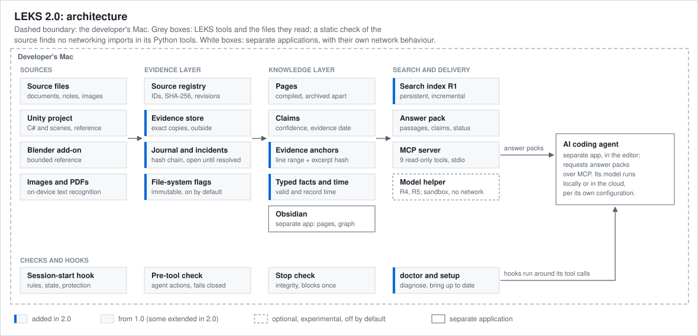

# Architecture

LEKS is a command-line tool (Python, standard library) and an MCP server around one folder of Markdown pages and registered source files. It runs on the developer's Mac, next to the project it documents.
- **People** open the same folder in Obsidian. They read and edit the pages and browse the link structure in a graph view. Obsidian reads the files directly; it does not use answer packs.
- **AI coding agents** request answer packs through the MCP server, and hooks check what they do with the files.

## Where each part runs, and how its network use is known

| Part | Where it runs | Network, and how it is known |
|---|---|---|
| LEKS tools: build, checks, search, answer packs, MCP server, hooks, evidence store | the developer's Mac | No networking imports. A static check in the test suite scans the source of these Python modules for networking modules and finds none; it checks the code, not run-time behaviour. They use only the standard library and talk to the agent over stdio. |
| Text-recognition helper for images and PDFs | the developer's Mac | Its source uses Apple's on-device Vision and PDFKit frameworks and makes no network calls of its own (code review only; no automated check) |
| Model helper for the optional experimental engines R4 and R5 | the developer's Mac, in a separate process | Denied by a macOS sandbox: a probe confirms that TCP connections, even to the local machine, are refused inside it, while the same probe outside connects. Its installer downloads pinned packages and model files once, at install time. |
| Obsidian, Unity, Blender, the code editor | the developer's Mac | Separate applications with their own network behaviour (updates, sync, extensions). LEKS does not control or verify it. |
| AI coding agent | in the code editor; its model runs locally or in the cloud, depending on the agent | Receives the answer packs it requests over MCP. What it does with them is governed by the agent and its configuration. |

The agent rules and the pre-tool check limit which files an agent may change. They do not control what an agent does with the text it reads.

## Components

| Component | What it does |
|---|---|
| Source registry | ID, SHA-256, size, origin, former paths and revisions of every source file. Moves and renames go through one command that keeps the ID and rewrites links. |
| Pages | Curated Markdown with front matter (summary, status, dates, keywords, sources). Archived pages are kept apart and are recognised by search. |
| Claims | Statements with confidence (verified, reported, inferred, planned, unknown), scope, evidence date, sources, supersession and recorded conflicts |
| Evidence anchors | For each active claim: the source ID, a line range and the hash of the cited excerpt. A check reports a changed, moved, missing, unregistered or superseded source file; it never re-links silently. |
| Typed facts and time | Typed facts (for example a build, a version or a decision) that cite anchors. Valid time comes from evidence dates and supersession, and record time from the change history of the claims. Contradictions and outdated pages are reported. |
| Build | Compiles indexes, the link graph and the search index snapshot. Deterministic. |
| Search | R1 by default (below). Source full-text search uses SQLite FTS5. |
| Answer pack | For a question: • the matching passages of the four best pages (weights 1, 0.6, 0.4, 0.3), limited to 1,800 estimated tokens (7,200 characters); • the claims of those pages and the next pages to read; • since 2.0, a field naming the engine and a fixed note that the passages are the closest matches, not a confirmed answer. A whole pack is about 11,000 to 11,500 characters, or about 2,800 to 2,900 estimated tokens. |
| MCP server | Nine read-only tools over JSON-RPC on stdio, seven of them in the public engine. Arguments are validated against the published schemas. |
| Hooks | Session-start hook: rules, current state and the evidence-protection status. Pre-tool check: before each tool call, a check of the agent's action against the write rules. Stop check: when an agent stops, the fast integrity check runs and blocks the turn once if the knowledge base is inconsistent. |
| Integrity check | The full mode hashes every source file; the fast mode trusts unchanged size and time stamps. Both validate links, anchors, metadata and indexes. |
| Evidence store | Exact copies of every registered source file, addressed by hash, outside the knowledge base, with registry checkpoints |
| Journal and incidents | A hash-chained log of evidence events whose head is copied outside on every append. Damage opens an incident that is shown at every session start until a person resolves it. |
| Obsidian | The same folder opened as an Obsidian vault: the interface for people to read and edit pages, with a graph view of the links. One colour configuration drives every view, and a check reports drift. |
| `doctor` and `setup` | `doctor` checks every layer and names the fix. `setup` brings indexes, the store and the file-system flags up to date, and does nothing on a second run. |
| Reference tooling | A Roslyn-based extractor turns the Unity project's C# code into a reference that agents query in small slices. Scenes, prefabs and a Blender add-on have bounded references too. A Unity Editor bridge opens the asset a note refers to. |
| Images and PDFs | The text-recognition helper reads PDF text layers and recognises text in images. The text joins the source full-text index. |
| Agent setup | Nine agent roles and fourteen skills for recurring procedures. Specialist roles report, and one role writes shared pages. AI work is attributed by model name. |

## Search: from R0 to R1

| | R0 (1.0) | R1 (2.0) |
|---|---|---|
| When pages are read | On every query: every page is read and tokenized | Once, at build time, into an in-memory index; a snapshot file serves cold starts |
| Ranking | BM25 with title weighting, a domain thesaurus, archive and current-state rules, and rules for reviews, procedures and dated records | The same scoring code, so rankings and scores are identical |
| Freshness | Always current, because it reads everything | Each query checks the size and time stamps of every page and re-indexes only the changed ones |
| Cost per query | Grows with the size of all pages | Grows with the number of matching terms, plus a quick time-stamp check of every page |

SQLite's built-in BM25 was considered for pages and rejected. It cannot reproduce the hand-written ranking rules exactly, and R1 had to return identical results.

## Experimental engines R4 and R5

- **R4:** R1's ranking fused with the ranking of a small embedding model (`bge-small-en-v1.5`) by reciprocal rank fusion. The archive rules are applied once, and archived pages are kept out of the first position unless a question asks about history.
- **R5:** a small cross-encoder (`ms-marco-MiniLM-L6-v2`) re-scores R4's top 20 results, and its order is combined with R4's.
- **Runtime:** both run in the model helper, a separate process with its own Python environment and ONNX Runtime on the CPU. A sandbox denies it network access.
- **Packages:** the packages and model files are pinned by SHA-256.
- **Default:** both engines are opt-in through configuration. The default R1 needs no extra packages.

## Version 1.0 compared with 2.0

| Layer | 1.0 | 2.0 |
|---|---|---|
| Search | R0 | R1 (identical rankings); R4 and R5 optional and experimental |
| Evidence | Registry and hashes | Plus evidence store, restore, journal, incidents and file-system flags |
| Claims | Whole-file sources | Plus hashed excerpt anchors, typed facts, valid and record time |
| Writes | Files rewritten in place | Atomic writes (temporary file, sync, rename) under a lock |
| Hooks | Session-start hook, pre-tool check, stop check | The same three; the stop check now catches in-place edits of source files, and the pre-tool check fails closed |
| Operations | Build and integrity check | Plus `doctor`, `setup` and a rehearsed migration with rollback |

The diagram and design notes of 1.0 are in its [archived README](history/README-1.0.md).
