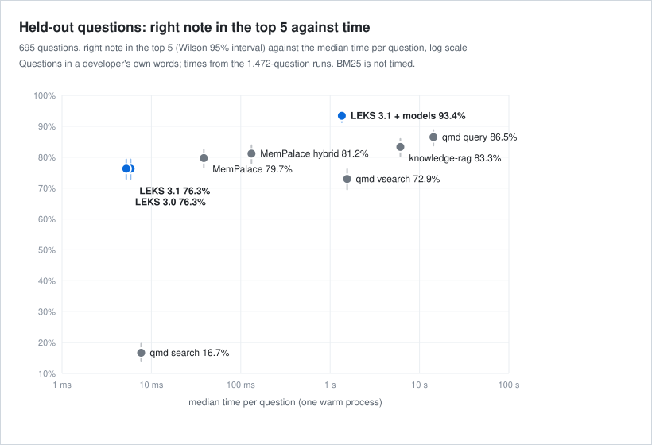
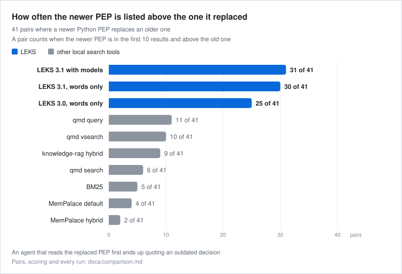

# Comparison with other local search tools

LEKS next to three open tools that search a folder of notes on your own machine with no API key, and next to
a plain BM25 baseline. Every system ran on the same notes and questions as the
[public benchmark](benchmark.md), plus two new question sets, each system with its own defaults, on one Mac
with Apple silicon.

**In short**

- **Held-out questions (q3).** With its two models LEKS 3.1 lists the right PEP in its top 5 for 93.4% of the 695 questions, and is better than each of the seven other configurations in the plan's tests (Holm p 1.2e-6 or lower). Next come qmd query with 86.5% and knowledge-rag with 83.3%. LEKS also puts the right PEP first most often: 62.9%, then knowledge-rag with 52.8%.
- **Words alone.** With no model LEKS 3.1 reaches 76.3% at about 6 ms and 63 MB. That is better than BM25 (66.2%) and qmd search (16.7%), within what these 695 questions can separate from qmd vsearch (72.9%) and MemPalace's default search (79.7%), and worse than the hybrid searches that run models: qmd query, knowledge-rag and MemPalace with BM25 candidates (81.2%).
- **Replaced notes.** LEKS lists the newer PEP above the one it replaced for 30 of 41 pairs on words alone and 31 with models, and points from the old PEP to the new one. The other tools list the newer PEP higher for 2 to 11.
- **Cost.** With models LEKS takes about 1.35 s per question, close to qmd vsearch (1.55 s) and well under knowledge-rag (6.1 s) and qmd query (14.3 s). MemPalace's small CPU model answers in 39 to 132 ms.

How this page was written. The notes, the questions, the two new question sets and the scoring rules were
fixed before any tool ran on them. The analysis of the held-out set q3 (its measures, the 16 paired tests
and the wording rule for this page) was written and hashed before any system saw a q3 question. Each tool ran
through a small adapter that indexes the notes with the tool's own command or library call, sends only the
question text and keeps the top 20 notes it returns. I report every configuration that ran, including the
ones where LEKS loses. Everything needed to recount the tables, and to rerun the systems, is in
[bench/compare](../bench/compare/README.md).

## 1. Systems

| system | version | what runs | models |
|---|---|---|---|
| bm25 | SQLite 3.53.3 | FTS5 `bm25()` over one row per note, as in the [benchmark](benchmark.md#4-systems) | none |
| leks-3.0 | 3.0.0 | the word lanes, `search(q, k=20, per_doc=1, rerank=True)` | none |
| leks-3.1 | 3.1.0 | the same call on LEKS 3.1 | none |
| leks-3.1-models | 3.1.0 | all lanes in strict mode, as in the benchmark | `lightonai/mDenseOn` (embedder) and `lightonai/mLateOn` (reranker) |
| qmd-search | 2.8.3 | `qmd search`: BM25 over SQLite FTS5 | none |
| qmd-vsearch | 2.8.3 | `qmd vsearch`: vector search after `qmd embed` | embeddinggemma 300M |
| qmd-query | 2.8.3 | `qmd query`: query expansion, BM25 and vectors fused, then a reranker | embeddinggemma 300M, a 1.7B query expansion model, Qwen3 reranker 0.6B |
| mempalace-default | 3.12.0 | `mempalace search` as shipped: a MiniLM vector pool re-ranked 0.6 cosine and 0.4 BM25 | all-MiniLM-L6-v2 |
| mempalace-hybrid | 3.12.0 | the MCP tool `mempalace_search` with `candidate_strategy="union"`, an option that merges BM25 candidates into the vector pool before the re-rank (its default takes vector candidates only) | all-MiniLM-L6-v2 |
| knowledge-rag-hybrid | 5.0.1 | `search_knowledge` in its default hybrid mode (alpha 0.3) with its reranker | bge-small-en-v1.5 (ONNX), ms-marco-MiniLM-L-6-v2 |

Every system answers all questions from one process. The adapters of qmd, MemPalace and knowledge-rag send
one untimed warm-up question before the timed ones; the LEKS runs send none, so their times include the
start-up of the first question. The qmd adapter keeps one node process that opens the index the way the CLI does and calls
the same library function with the same options, so its times leave out the start of a new process. Both
MemPalace rows asked for 100 results, so that hit@5 and MRR@10 count on a full top 10; section 4.2 shows what
5 and 10 change. Model downloads happened once before the runs, and no run fetched anything.

## 2. Questions

The notes are the 714 PEPs of the benchmark, converted to Markdown at the pinned commit.

| set | n | what it asks |
|---|---|---|
| q1 | 695 | a PEP by its title, as written |
| q1p | 695 | the same PEP in other words: a paraphrased title lookup |
| q2 | 41 | a PEP that a newer one replaced, asked by the old title |
| q2c | 41 | the same with "current" in the question |
| q3 | 695 | the need of a developer who would look for that PEP, in their own words: the held-out set |

q1, q2 and q2c are the benchmark's sets. Two sets were added for this comparison, both written with a model,
one question at a time, under a fixed rule, then checked by a script and frozen before any system ran on
them:

- q1p, frozen at 2026-11-14 00:23 UTC: one paraphrase per q1 title. English, 4 to 14 words, no PEP number,
  the title's words replaced by synonyms or a description, less than half of the title's content words kept.
- q3, frozen at 2026-11-14 01:23 UTC: one question per q1 PEP, written from the PEP's abstract as a
  developer who needs that PEP would ask it. English, 6 to 22 words, never the word PEP or a PEP number, no
  run of five words copied from the abstract. The writers saw no system output and no q1p question.

q3 is the set the conclusions rest on. The three title sets favour a tool that matches words, and LEKS was
built with the benchmark's sets in view; nobody tuned anything with q3 in view. The file names and hashes
are in [bench/compare](../bench/compare/README.md).

## 3. Measures

The benchmark's measures, unchanged: hit@1, hit@5 and MRR@10 for q1, q1p and q3; for q2 and q2c the share
of pairs where the newer PEP is in the top 10 and above the replaced one, and, apart from it, whether a
listed replaced PEP points to its successor (only LEKS gives such a pointer). The top 10 counts, and rates
carry Wilson 95% intervals. I give no number pooled over the sets: they ask different things.

On q3, hit@5 is the primary measure. The plan fixed 16 paired comparisons before the q3 runs: LEKS 3.1 with
models against BM25 and against each of the six configurations of the other tools, LEKS 3.1 words only
against the same seven, LEKS 3.1 with models against words only, and LEKS 3.1 against 3.0. Each is a
two-sided exact McNemar test on the questions one system found and the other missed, with one Holm
correction over all 16. The page says "better" or "worse" only where the corrected p is below 0.05.

Cost per system: the median and 95th percentile time per question, the time to build the index from
scratch and the largest resident memory of the run (section 4.4 says how it was taken).

## 4. Results

### 4.1 Held-out questions (q3)

Rates in percent with their Wilson 95% intervals; MRR@10 as a fraction.

| system | hit@1 | hit@5 | MRR@10 |
|---|---|---|---|
| bm25 | 41.3 (37.7 to 45.0) | 66.2 (62.6 to 69.6) | 0.522 |
| leks-3.0 | 44.3 (40.7 to 48.0) | 76.3 (73.0 to 79.3) | 0.577 |
| leks-3.1 | 44.2 (40.5 to 47.9) | 76.3 (73.0 to 79.3) | 0.576 |
| leks-3.1-models | 62.9 (59.2 to 66.4) | 93.4 (91.3 to 95.0) | 0.757 |
| qmd-search | 13.2 (10.9 to 16.0) | 16.7 (14.1 to 19.6) | 0.148 |
| qmd-vsearch | 38.0 (34.5 to 41.7) | 72.9 (69.5 to 76.1) | 0.528 |
| qmd-query | 35.8 (32.3 to 39.5) | 86.5 (83.7 to 88.8) | 0.576 |
| mempalace-default | 45.9 (42.2 to 49.6) | 79.7 (76.6 to 82.5) | 0.601 |
| mempalace-hybrid | 41.6 (38.0 to 45.3) | 81.2 (78.1 to 83.9) | 0.580 |
| knowledge-rag-hybrid | 52.8 (49.1 to 56.5) | 83.3 (80.4 to 85.9) | 0.656 |

The 16 fixed comparisons on q3 hit@5. "Only A" counts the questions A found in its top 5 and B did not;
the last column gives the q1p difference of the same pair beside it, without a test.

| A | B | A hit@5 | B hit@5 | only A | only B | p | Holm p | q1p A minus B |
|---|---|---|---|---|---|---|---|---|
| leks-3.1-models | bm25 | 93.4 | 66.2 | 198 | 9 | 1.6e-47 | 2.3e-46 | +20.6 |
| leks-3.1-models | qmd-search | 93.4 | 16.7 | 535 | 2 | 6.4e-157 | 1e-155 | +53.2 |
| leks-3.1-models | qmd-vsearch | 93.4 | 72.9 | 153 | 11 | 3.8e-33 | 4.9e-32 | +11.5 |
| leks-3.1-models | qmd-query | 93.4 | 86.5 | 67 | 19 | 1.9e-07 | 1.2e-06 | +0.4 |
| leks-3.1-models | mempalace-default | 93.4 | 79.7 | 104 | 9 | 1.3e-21 | 1.4e-20 | +9.4 |
| leks-3.1-models | mempalace-hybrid | 93.4 | 81.2 | 91 | 6 | 1.3e-20 | 1.3e-19 | +9.5 |
| leks-3.1-models | knowledge-rag-hybrid | 93.4 | 83.3 | 82 | 12 | 5.6e-14 | 5.1e-13 | +6.3 |
| leks-3.1 | bm25 | 76.3 | 66.2 | 113 | 43 | 1.9e-08 | 1.5e-07 | +5.3 |
| leks-3.1 | qmd-search | 76.3 | 16.7 | 423 | 9 | 2.4e-112 | 3.7e-111 | +38.0 |
| leks-3.1 | qmd-vsearch | 76.3 | 72.9 | 113 | 90 | 0.12 | 0.24 | -3.7 |
| leks-3.1 | qmd-query | 76.3 | 86.5 | 46 | 117 | 2.5e-08 | 1.8e-07 | -14.8 |
| leks-3.1 | mempalace-default | 76.3 | 79.7 | 48 | 72 | 0.035 | 0.11 | -5.9 |
| leks-3.1 | mempalace-hybrid | 76.3 | 81.2 | 41 | 75 | 0.002 | 0.0082 | -5.8 |
| leks-3.1 | knowledge-rag-hybrid | 76.3 | 83.3 | 34 | 83 | 6.8e-06 | 3.4e-05 | -8.9 |
| leks-3.1-models | leks-3.1 | 93.4 | 76.3 | 126 | 7 | 2.4e-29 | 2.9e-28 | +15.3 |
| leks-3.1 | leks-3.0 | 76.3 | 76.3 | 0 | 0 | 1 | 1 | +0.1 |

LEKS with models is ahead on every q3 measure. The closest configuration in the tests is qmd query: 67
questions only LEKS found in its top 5, against 19 only qmd query found (Holm p 1.2e-6). The models add 17.1
points to LEKS on words alone (126 questions against 7). On words alone LEKS 3.1 is better than BM25 (113
against 43, Holm p 1.5e-7) and qmd search; within what these 695 questions can separate from qmd vsearch
(Holm p 0.24) and MemPalace's default search (0.11); and worse than MemPalace with BM25 candidates (0.0082),
knowledge-rag (3.4e-5) and qmd query (1.8e-7). LEKS 3.1 and 3.0 find the same q3 questions in their top 5:
3.1 changed no search lane.

The title sets rank qmd query differently. On q1p, the paraphrased titles, it is level with LEKS with models
on hit@5 (90.6% against 91.1%); on q3, the set fixed before the runs, it is 6.9 points behind. qmd search
joins the words of a question with AND (section 4.2) and finds 16.7% of the q3 questions.

The miss audit the plan fixed. LEKS with models misses 46 q3 questions at hit@5, qmd query 94. I drew 20 of
each with the plan's seed and judged all 40 on one sheet that named no system, by the rule written before
the data: the top hit's title or abstract states what the question asks for. Only then did I open the key.
2 of the 20 on each side have such a top hit. The one-right-note rule thus costs both systems a similar
share of their misses and does not explain the gap between them; with 20 items per side the share is a
rough estimate. Every item and judgment is in
[`miss_audit_q3.json`](../bench/compare/miss_audit_q3.json).

### 4.2 Titles and paraphrased titles (q1, q1p)

| system | hit@1 | hit@5 | MRR@10 |
|---|---|---|---|
| bm25 | 80.6 (77.5 to 83.3) | 96.7 (95.1 to 97.8) | 0.875 |
| leks-3.0 | 90.1 (87.6 to 92.1) | 98.4 (97.2 to 99.1) | 0.938 |
| leks-3.1 | 89.4 (86.8 to 91.4) | 98.4 (97.2 to 99.1) | 0.934 |
| leks-3.1-models | 95.0 (93.1 to 96.4) | 100.0 (99.5 to 100.0) | 0.974 |
| qmd-search | 75.7 (72.4 to 78.7) | 92.2 (90.0 to 94.0) | 0.826 |
| qmd-vsearch | 68.3 (64.8 to 71.7) | 91.2 (88.9 to 93.1) | 0.783 |
| qmd-query | 74.1 (70.7 to 77.2) | 95.5 (93.7 to 96.8) | 0.838 |
| mempalace-default | 93.5 (91.4 to 95.1) | 98.7 (97.6 to 99.3) | 0.960 |
| mempalace-hybrid | 94.2 (92.3 to 95.7) | 99.3 (98.3 to 99.7) | 0.963 |
| knowledge-rag-hybrid | 94.5 (92.6 to 96.0) | 100.0 (99.5 to 100.0) | 0.970 |

The pooled title rate mixes two kinds of title. 33 of the 695 PEPs were replaced by a newer one, and for
those LEKS lists the newer PEP first on purpose (section 4.3): it puts the asked PEP first for 5 of the 33,
with or without models, the other systems for 21 to 28. On the other 662 titles, LEKS with models puts the
asked PEP first for 655 (98.9%), knowledge-rag for 630 (95.2%), the two MemPalace rows for 624 and 627,
LEKS 3.1 on words alone for 616 (93.1%) and BM25 for 538.

| system | hit@1 | hit@5 | MRR@10 |
|---|---|---|---|
| bm25 | 42.7 (39.1 to 46.4) | 70.5 (67.0 to 73.8) | 0.542 |
| leks-3.0 | 46.3 (42.7 to 50.0) | 75.7 (72.4 to 78.7) | 0.582 |
| leks-3.1 | 46.0 (42.4 to 49.8) | 75.8 (72.5 to 78.9) | 0.581 |
| leks-3.1-models | 62.7 (59.1 to 66.2) | 91.1 (88.7 to 93.0) | 0.747 |
| qmd-search | 28.1 (24.8 to 31.5) | 37.8 (34.3 to 41.5) | 0.322 |
| qmd-vsearch | 46.8 (43.1 to 50.5) | 79.6 (76.4 to 82.4) | 0.605 |
| qmd-query | 45.9 (42.2 to 49.6) | 90.6 (88.3 to 92.6) | 0.653 |
| mempalace-default | 47.8 (44.1 to 51.5) | 81.7 (78.7 to 84.4) | 0.621 |
| mempalace-hybrid | 44.2 (40.5 to 47.9) | 81.6 (78.5 to 84.3) | 0.597 |
| knowledge-rag-hybrid | 52.8 (49.1 to 56.5) | 84.7 (81.9 to 87.2) | 0.663 |

Paraphrased titles change the order. LEKS with models has the highest hit@1 (62.7%) and MRR@10 (0.747),
where knowledge-rag comes next (0.663), then qmd query (0.653); on hit@5 qmd query is level with it (90.6%
against 91.1%). On words alone LEKS keeps 46.0% hit@1, near qmd vsearch, MemPalace and BM25. qmd search
joins the words of a question with AND (its `store.js` builds the query that way), so a paraphrase that
brings in one word the note lacks finds nothing: 37.8% hit@5 here against 92.2% on the titles.

MemPalace and the size of the request. MemPalace re-ranks only the pool it fetched, so the number of
results asked for moves its first place a little. Counts of the 695 questions:

| MemPalace setting | results asked | q1 hit@1 | q1p hit@1 | q1p hit@5 |
|---|---|---|---|---|
| `mempalace search`, the mempalace-default row | 100 | 650 | 332 | 568 |
| `mempalace search` | 10 | 645 | 336 | 575 |
| `mempalace search` | 5 | 643 | 337 | 537 |
| MCP tool, vector candidates (its default) | 10 | 649 | 333 | 571 |
| MCP tool, vector candidates (its default) | 5 | 646 | 330 | 523 |
| MCP tool, union, the mempalace-hybrid row | 100 | 655 | 307 | 567 |
| MCP tool, union | 10 | 648 | 335 | 564 |
| MCP tool, union | 5 | 647 | 344 | 512 |

Its best q1p hit@1 is 344 (49.5%), with the union pool and 5 results. LEKS with models puts the right note
first for 436 (62.7%); an exact McNemar test against each of the eight settings gives p of 1.4e-9 or lower.

### 4.3 Newer over replaced (q2, q2c)

| system | newer above replaced | replaced first | pointer to the newer (of shown) |
|---|---|---|---|
| bm25 | 5 of 41 | 36 | none |
| leks-3.0 | 25 of 41 | 16 | 25 of 40 |
| leks-3.1 | 30 of 41 | 11 | 33 of 40 |
| leks-3.1-models | 31 of 41 | 10 | 33 of 40 |
| qmd-search | 6 of 41 | 34 | none |
| qmd-vsearch | 10 of 41 | 30 | none |
| qmd-query | 11 of 41 | 29 | none |
| mempalace-default | 4 of 41 | 37 | none |
| mempalace-hybrid | 2 of 41 | 39 | none |
| knowledge-rag-hybrid | 9 of 41 | 32 | none |

| system | newer above replaced | replaced first | pointer to the newer (of shown) |
|---|---|---|---|
| bm25 | 5 of 41 | 36 | none |
| leks-3.0 | 25 of 41 | 15 | 19 of 34 |
| leks-3.1 | 32 of 41 | 8 | 28 of 35 |
| leks-3.1-models | 32 of 41 | 9 | 33 of 40 |
| qmd-search | 6 of 41 | 31 | none |
| qmd-vsearch | 11 of 41 | 29 | none |
| qmd-query | 10 of 41 | 30 | none |
| mempalace-default | 6 of 41 | 35 | none |
| mempalace-hybrid | 3 of 41 | 38 | none |
| knowledge-rag-hybrid | 14 of 41 | 27 | none |

Each replaced PEP names its successor in its header, and the notes keep that as `superseded_by` in their
front matter. LEKS reads that field: it lists the newer PEP above the replaced one for 30 of the 41 q2 pairs
on words alone and 31 with models, against 25 for LEKS 3.0, and when it still shows the replaced PEP it
points to the newer one. The other tools make no use of the field and rank by closeness to the question,
which is the old title, so the old PEP mostly comes first: they list the newer PEP above it for 2 to 11 of
the 41. The pointer column stands apart because only LEKS has one.

### 4.4 Cost

From the runs over all 1,472 known questions (q1, q1p, q2 and q2c), one run at a time.

| system | median ms per question | 95th percentile ms | index build s | peak resident memory MB |
|---|---|---|---|---|
| bm25 | not timed | not timed | not timed | 63.6 |
| leks-3.0 | 5.2 | 11.3 | 8.4 | 66.5 |
| leks-3.1 | 5.9 | 17.8 | 7.3 | 63.2 |
| leks-3.1-models | 1350.3 | 1763.9 | 605.1 | 1434.0 |
| qmd-search | 7.7 | 33.1 | 3.0 | 202.2 |
| qmd-vsearch | 1551.2 | 7659.2 | 357.1 | 3064.5 |
| qmd-query | 14308.7 | 20370.0 | 350.8 | 4978.3 |
| mempalace-default | 38.6 | 39.3 | 473.5 | 1222.6 |
| mempalace-hybrid | 131.9 | 161.0 | 472.8 | 1302.5 |
| knowledge-rag-hybrid | 6099.5 | 7412.7 | 930.9 | 3188.3 |

On words alone LEKS answers in about 6 ms per question and holds 63 MB, after building its index in 7.3 s;
qmd search takes 7.7 ms and 202 MB. With its models LEKS takes about 1.35 s per question, less than qmd
vsearch (1.55 s), knowledge-rag (6.1 s) and qmd query (14.3 s). MemPalace, which runs a small embedding model
on the CPU, answers in 39 to 132 ms. Building the index from scratch takes about 10 minutes for LEKS with
models, 6 for qmd's vector index, 8 for MemPalace and 15.5 for knowledge-rag.

The memory column is the largest resident size of each run as the operating system reports it. For LEKS with
models it adds the search process and the model helper, sampled every 0.1 s in a second run of the same
questions that returned the same hits. Memory a run keeps on the GPU may not show in a resident size, so the
three GPU runs (qmd vsearch, qmd query and LEKS with models) can read low here: measured the way the
[results](results.md#scope) does it, the LEKS model helper holds about 6.8 GiB under load. What these
searches change in an agent's bill is in the [results](results.md#cost).

## 5. Limits

- One corpus. PEPs are English, technical and have distinctive titles. Notes in another language or with
  less distinctive titles may rank differently.
- One known note per question, from its title, a paraphrase or a need, and the newer of two notes.
  Questions that need a passage from deep inside a long note, or several notes at once, are not measured
  here.
- q1p and q3 were written with a model. Text written by one model may sit closer to what an embedding model
  expects than a person's own words would.
- q1p was written after I had seen how every system did on the titles. q3, whose analysis was fixed before
  any run, is the set the conclusions rest on.
- q2 and q2c test a feature of LEKS on notes that carry the field it reads. 38 of the 41 q2 questions are
  the q1 question of the replaced PEP, so on those a system cannot win both sets. One pair joins PEP 543,
  withdrawn, to PEP 748, the draft that took its place; leaving it out moves no system past another in the
  q2 and q2c tables.
- Defaults only. Each tool may do better with settings tuned to this corpus; LEKS ran with its defaults too.
  MemPalace is built mainly as a memory for conversations, so a notes corpus is not its home ground.
- One right note per question. Each q3 question was written from one note's abstract, and only that note
  counts. When another note also answers the question, a system that lists that note first loses the
  point, so the q3 rates are lower bounds. The miss audit in section 4.1 sizes this.
- qmd query expands each question with a model that samples (temperature 0.7 in its code), so a second run
  of the same question can list other notes.
- No run downloads anything: the models were in place before, and every run had the offline settings of
  its tool. qmd has no offline switch, so its runs pointed every proxy setting at an address that leads
  nowhere. The runs in a macOS sandbox could reach only a short list of hosts through a filter; the three
  runs started from a terminal because they use the GPU (qmd vsearch, qmd query and LEKS with models) had no
  such filter.
- Times come from one Mac. The model runs of qmd and LEKS used the GPU; MemPalace and knowledge-rag ran
  their ONNX models on the CPU, which is their default. The q3 runs are not timed: most of them overlapped.

## 6. Recount and rerun

Every table on this page comes from three small files in [bench/compare](../bench/compare/README.md): the
rank at which each system listed the right note for each question, the same for the pairs, and the cost of
each run. `python bench/compare/score.py` prints every table, the 16 tests included, with Python 3.10 or
newer and nothing else. The same folder holds the two new question sets, the q3 analysis plan with its hash,
and the adapters that ran the other tools, so each run can be repeated.
