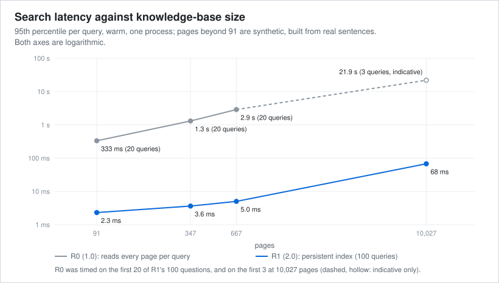

# Efficiency

What version 2.0 saves compared with 1.0, in three categories:
- **Measured:** observed on this machine with the harness described in [benchmarks and methodology](benchmarks.md#performance-measurements).
- **Modelled:** computed from measured inputs and an assumed agent behaviour.
- **Not verified:** plausible, but not measured. It is not claimed.

No money or token savings are claimed for 2.0. The data does not support them (see below).

## Measured

### Latency and memory (performance harness, 217 questions, same data and machine)

| Operation | 1.0 (R0) | 2.0 (R1) | Saved per call |
|---|---:|---:|---:|
| Page search, p95 | 351 ms | 2.0 ms | 349 ms |
| Answer pack, p95 | 379 ms | 37 ms | 342 ms |
| Answer pack through the MCP server, p95 | 371 ms | 37 ms | 334 ms |
| Answer pack in a new process, median | 297 ms | 102 ms | 195 ms |
| Full integrity check, peak memory | 1,602 MB | 82 MB | 1,520 MB |
| Full integrity check, time | 8.2 s | 7.7 s | 0.5 s |

Version 2.0 checks more, so some operations got more expensive:

| Operation | 1.0 | 2.0 |
|---|---:|---:|
| Fast integrity check (the stop check) | 1.1 s, 50 MB | 1.5 s, 57 MB |
| MCP server, steady memory | 42 MB | 51 MB |
| MCP status tool (reports the integrity state) | 1.1 s | 1.7 s |

### Indexing and updates

R0 has no index: it pays the full cost of reading every page on every query. R1 pays once at build time and then only for changed pages.

| Pages | R1 index build | Next search after one changed page | Index snapshot |
|---:|---:|---:|---:|
| 91 (the real knowledge base) | 0.7 s | 0.014 s | 0.5 MB |
| 347 | 2.9 s | 0.021 s | 3.3 MB |
| 667 | 5.8 s | 0.026 s | 6.8 MB |
| 10,027 | 103 s | 0.077 s | 110 MB |

### Scaling

| Pages | R1 search p95 (100 queries) | R0 search p95 (queries) |
|---:|---:|---:|
| 91 | 2.3 ms | 333 ms (20) |
| 347 | 3.6 ms | 1,311 ms (20) |
| 667 | 5.0 ms | 2,882 ms (20) |
| 10,027 | 67.6 ms | 21.9 s (3; indicative only) |

From 91 to 10,027 pages, R1's p95 grows about 30 times for 110 times more pages.

#### Measurement limits

- **Unequal query counts.**
  - R1 was timed on 100 questions at every size.
  - R0, which takes seconds per query at larger sizes, was timed on the first 20 of the same 100 questions, and at 10,027 pages on the first 3 only.
  - With 3 samples, R0's "p95" is in effect the slowest of three queries. The 21.9 s figure is indicative, and the R0 against R1 factor at 10,027 pages is an order of magnitude, not a measurement.
- **Synthetic pages.**
  - Every size beyond 91 pages adds synthetic pages, built from sentences of the real pages (about 10 % near-duplicates), to the 91 real ones.
  - Synthetic pages are longer than real ones.
- **One run.** Each size was run once, on one machine, in one process that also generated the pages.
- **Lower sizes are firmer.** At 91, 347 and 667 pages both engines were timed on 20 or more of the same questions, so these comparisons are firmer.

### Context an agent receives

| Context | 1.0 | 2.0 |
|---|---:|---:|
| Loaded at every session start (rules and current state) | about 2,500 tokens | about 2,500 tokens |
| One answer pack, median | about 2,800 tokens | about 2,860 tokens |

Both are estimates (characters divided by 4) of everything returned:
- **The 1,800-token budget** applies only to the page passages inside the pack. The claims, next pages and status fields come on top of it.
- **No reduction in 2.0:** version 2.0 does not reduce what an agent reads.
- **Slightly larger packs:** about 2 % larger, because each pack now names its engine and carries a fixed note that its passages are not a confirmed answer. Re-running the development evaluation with these changed no ranking, coverage or verdict.

## Modelled (1.0 only)

The report of 1.0 modelled the number of agent steps needed per question of the 1.0 benchmark (177 questions).
- **The model's assumption:** the agent first calls the answer pack (or, without one, the search). If the pack does not hold every answer key, it reads whole pages in ranked order until one does, at most five.
- **Measured input:** whether the answer pack held every key for each question.

| Configuration | Questions answered by the first call | Modelled steps per question |
|---|---:|---:|
| Earlier engine, replaced by R0; no answer pack | 0 % | 3.40 |
| R0, no answer pack | 0 % | 3.23 |
| R0, answer pack with the best page only | 57.1 % | 2.63 |
| R0, answer pack with the four best pages (1.0) | 70.6 % | 2.31 |

**What this shows:** together, R0's search changes and the four-page pack cut modelled steps by about a third (3.40 → 2.31); the pack alone, from 3.23 to 2.31.

**What it does not show:**
- **No figure for 2.0.** The model was not re-run for 2.0, so no step count is given for it. R1's rankings are identical to R0's, but this alone does not establish the model's result.
- **No observed behaviour.** Real agents were not observed taking these steps.

## Not verified

- Whether faster local search lets an agent finish a task with fewer steps or tokens. Local latency (tens of milliseconds) is small next to a language model's response time.
- Whether evidence anchors and the "not a confirmed answer" note reduce wrong answers by agents.
- Any money saving. An agent's cost depends on its provider, model, plan and session length, none of which 2.0 changes. No reliable cost data per question exists for 2.0.

## Summary

Version 2.0 saves local computation:
- **Search and answer packs:** 2.9 to 176 times faster.
- **Memory:** about 1.5 GB less peak memory for the full integrity check.
- **Updates:** milliseconds after a page changes.
- **Scaling:** 68 ms search p95 at 10,027 pages (latency only).

The context an agent reads stays about the same (packs about 2 % longer), and no change in agent steps or cost is claimed.
