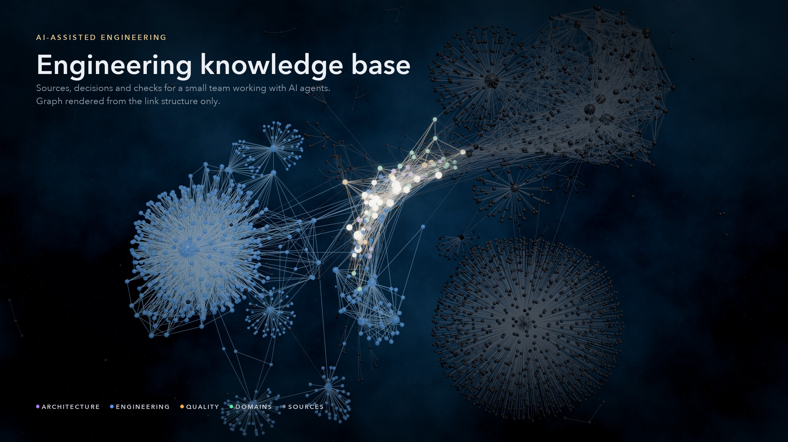
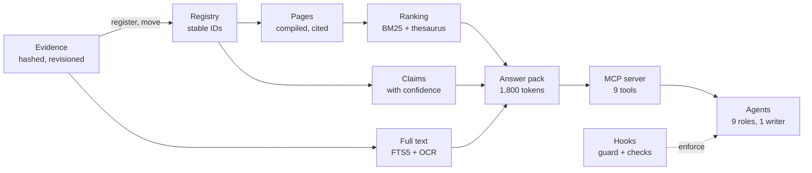
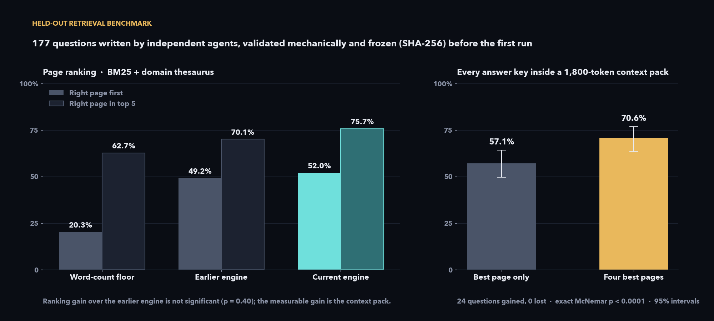
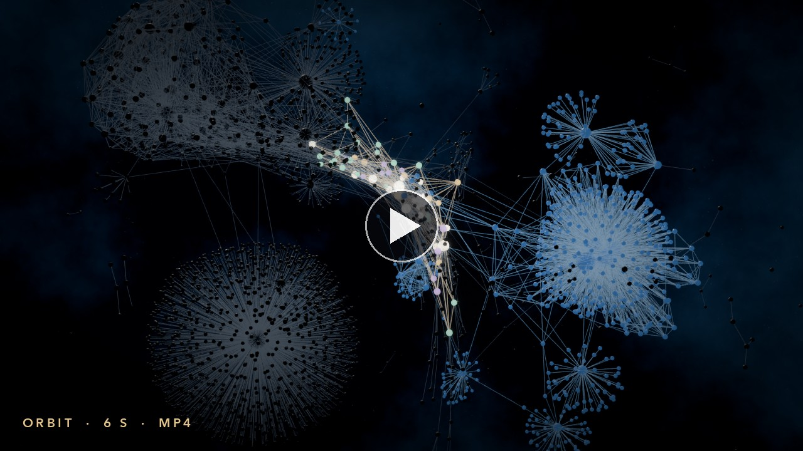

> **Archived README of version 1.0**, published earlier under the title "Engineering knowledge base". Kept as published, apart from image paths and a few small edits. Its figures describe 1.0; [the version history](../version-history.md) records what changed in 2.0 and which statements were superseded.

# Engineering knowledge base for AI coding agents

AI coding agents are only as reliable as the context they load. On a long-running engineering project that context is messy: notes contradict each other, decisions get revised, and last month's draft reads exactly like this month's plan. I designed and built a knowledge system that gives people and agents one verified, dated context, and I measured whether it works.

It runs locally next to the project it documents: standard-library Python, no external services. The retrieval and OCR tools make no network calls.

| | |
|---:|---|
| **≈ 70 %** | of held-out questions have every answer key inside one 1,800-token context pack, up from 57 % (24 gained, 0 lost; exact McNemar p < 0.0001) |
| **2.31** | agent steps per question (modelled), down from 3.40; about a third less model cost per question |
| **0.41 s** | p99 latency of an answer pack over 1,000 calls |
| **2,800+** | evidence files, SHA-256-hashed; every in-place change is a recorded revision, and renames keep IDs and history |
| **114** | claims with confidence, scope, evidence date and sources |
| **105** | automated tests; key rules enforced by hooks, not only by prompts |

**Stack:** Python (standard library, SQLite FTS5) · Model Context Protocol (JSON-RPC over stdio) · C# (Roslyn, Unity Editor) · Swift (Vision, PDFKit) · JavaScript (Three.js, GLSL) · custom agents, skills and hooks for AI coding assistants

## How it works

## Design decisions

### Evidence is protected; knowledge is compiled from it

- Sources are stored as received and hashed. A correction is a new source plus an edit to the compiled page; the few in-place changes to evidence, such as translations and link rewrites after a rename, are recorded revisions.
- Moves and renames go through one command that keeps the ID, records former paths, rewrites links and logs a revision, so old references still resolve.
- A translation is recorded as a rendition of its original, so every English sentence points back to the source it came from.

### Facts carry their confidence

- Facts live apart from prose, as claims: verified, reported, inferred, planned or unknown, each with a scope, an evidence date and sources. A superseded claim stays, linked to its successor.
- Built, installed, launched and accepted on the device are different results and are recorded as such.
- Drafts and dormant work are archived explicitly, so an agent is far less likely to present an old proposal as the current plan.

### Retrieval is measured, not assumed

- **Method.** 177 questions written from the pages by six independent agents, without access to the search code. Every answer key is copied verbatim from its source page and checked mechanically. The set was frozen by SHA-256 and committed with the engine before the first run; a separate 176-question set was used for tuning.
- **Comparison.** Five engines answer the same questions, from a word-count floor to the current engine, with paired exact McNemar tests on the questions where two engines differ.
- **Result.** Every answer key is inside the context pack for 70.6 % of questions (Wilson 95 % interval 63.5 to 76.8 %), against 57.1 % when the pack held only the best page; a re-run after later documentation changes gave 69.5 %.
- **Limits, reported as such.** The ranking gain over the earlier engine is not significant (p = 0.40). Paraphrased questions are the weak spot: 47.7 % inside the pack, against 83.9 % for naturally phrased ones.
- **Tested and rejected.** On-device sentence embeddings put the right page first for 8.5 to 16.5 % of questions, against 52.3 % for BM25, and reciprocal rank fusion (24 settings) never beat BM25 alone. Light stemming lowered first-place accuracy. Neither shipped.

### Built for the economics of agents

- Measured on real sessions: every agent step re-reads the whole context, so cost grows roughly with the square of session length. One long session had 8.9 times the context of a short one and cost 243 times as much.
- One MCP call returns what most questions need: the matching passages of the four best pages (weights 1, 0.6, 0.4, 0.3), their claims with confidence and the next pages to read, within 1,800 tokens.
- The context loaded at every session start is about 4,800 tokens.

### Key rules live in code, not only in prompts

- **Session start:** a hook injects the rules and the current state.
- **Before every tool call:** a guard blocks edits to evidence, generated files and protected folders, and destructive git commands.
- **When an agent stops:** an integrity check runs, and an inconsistent knowledge base blocks the turn once.
- The checks cover links, claim references, source hashes, page metadata, naming, language and archive boundaries. Build and check are deterministic.

### Code that agents can query without loading it

- A Roslyn extractor (C#, .NET) parses every C# file of the Unity project under several preprocessor configurations (no symbols, all symbols, each symbol alone) and merges the syntax trees by span, so platform-specific `#if` branches are covered too.
- Scenes and prefabs are read from their serialized form, and a drift check compares the reference with the source snapshot it was built from.
- Agents query bounded slices (a class, a method, a scene object) through the same MCP server instead of reading files. The Blender tooling has an equivalent reference, and a Unity Editor bridge opens the asset a note refers to.

### Images and PDFs are searchable, on the device

- A Swift helper reads PDF text layers exactly (PDFKit) and recognises text in screenshots and scans with a confidence per line (Vision): 878 files in 45 seconds, 99.42 % character accuracy on synthetic screenshots of sentences not used for tuning.

### Many specialists, one writer

- Nine agent roles (architecture, Unity, Blender, content, product, research, review, knowledge, orchestration) and fourteen skills for recurring procedures: ingesting a source, recording a decision or a delivery, propagating a changed fact, handing off a session.
- Specialists return reports and one role merges them into shared pages, for the same reason a database serialises writes.
- Agents propose; people decide. AI contributions are attributed by model name.

## Graph view

A 3D view of the knowledge graph, built as a local extension of a graph plugin: instanced planets with custom GLSL materials, camera fitting that reads the physics engine's packed position buffer, a guided tour, a note inspector and support for reduced motion. One colour configuration drives every view of the vault, and a check reports any drift.

[Open the orbit video](../../media/graph-orbit.mp4)

The project content is not published. The figures describe the tooling, not the project, and the images show the structure of the graph only.

© 2026 Jakub Majewski. Text and media: all rights reserved.
