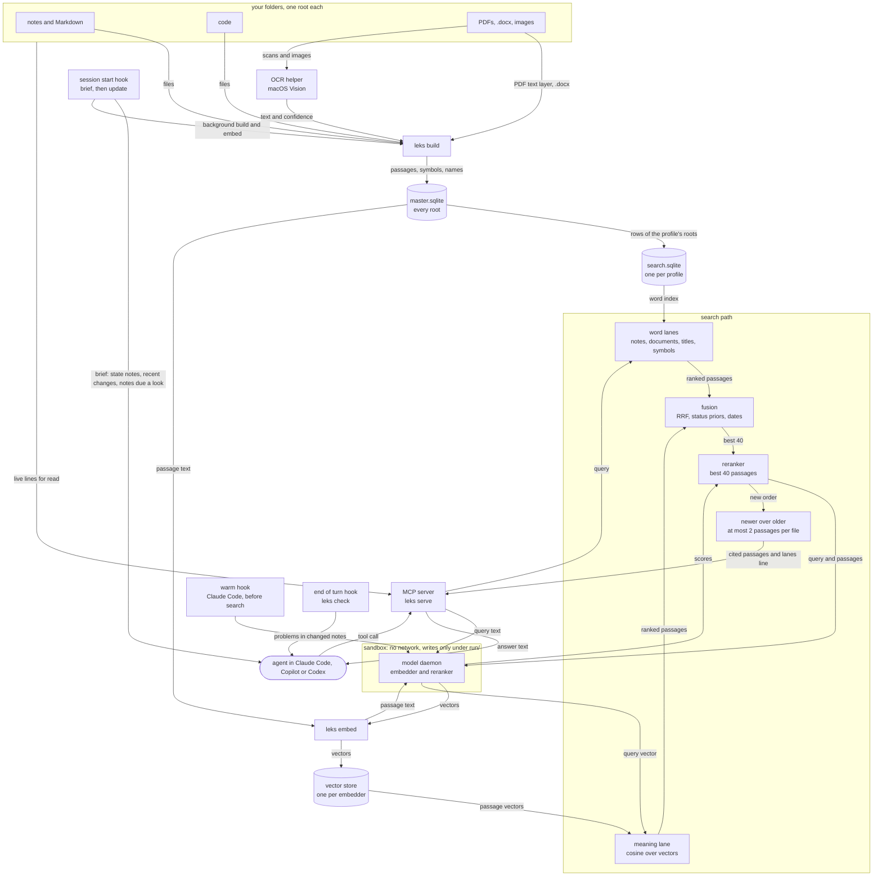

# How it works



That's the whole thing on one page. I build the index from my folders, and a hook keeps it fresh. The agent only ever talks to the MCP server. The two models live in their own process inside a sandbox, and all they ever get is text, all they hand back is numbers. If the models are missing, search still runs on words and its last line tells you so.

The rest of this page goes through each box. Setup is in [install.md](install.md), keys in [configuration.md](configuration.md), commands in [cli.md](cli.md), host setup in [hosts.md](hosts.md).

## The parts

- `leks build` walks the roots, reads what changed, and writes `index/master.sqlite`. Then it rebuilds one search database per profile.
- The OCR helper is a small Swift program that reads scanned PDFs and images on macOS. `leks ocr build` compiles it.
- `leks embed` sends passage text to the model daemon and stores the vectors that come back.
- The model daemon is one shared process that holds the embedder and the reranker. Text goes in, numbers come out.
- `leks serve` is the MCP server. It answers seven read-only tools over stdio.
- The hooks connect it all to a host: a brief and a background update at session start, a warm-up before a search, and the notes check at the end of a turn.

## Building the index

### The walk

`leks build` goes through every root of the config. The rules for what is skipped (junk names, build folders, secret names, symbolic links, deep folders, names that are not UTF-8) are in [configuration.md](configuration.md#roots). Every file the walk reaches gets a name row, up to `limits.max_names`, so `locate` can find it. Files that match the root's `include` globs also have their content read.

A file whose size and modification time match the last build is left alone. When one of them differs, the build hashes the bytes; same hash means only the time is updated. A changed file is read again and its old passages are replaced. A file that has gone away loses its rows. A root whose folder is missing keeps its rows and the log says `root not reachable, kept as is: <name>`.

The build logs one line per run, `update: seen N, indexed N, unchanged N, removed N, skipped N, errors N, ocr N, S.Ss`, and one line per profile.

### Skip reasons

A file that is wanted but cannot be indexed keeps its name row and gets one of these reasons, never free text:

| Reason | When |
|---|---|
| `secret pattern` | the text holds a key, a token or a password ([configuration.md](configuration.md#roots) lists the patterns) |
| `over size limit` | the file is bigger than its limit in `limits` |
| `binary content` | a zero byte in the opening 8000 bytes of a text file |
| `unreadable` | a PDF, `.docx` or image could not be opened while it was read |
| `no document extractor` | the document reader could not be loaded |
| `no pdf text extractor` | a PDF, and neither `pypdf` nor the OCR helper is there |
| `ocr off or helper not built` | a scanned PDF or an image, and OCR cannot run |
| `no usable text` | the extractor ran and found nothing worth keeping |
| `extract failed` | the extractor ran into an error |
| `unsupported type` | the document reader got a type it does not handle |

Four of them (`no document extractor`, `no pdf text extractor`, `ocr off or helper not built`, `no usable text`) can clear up once a tool shows up, so they are tried again when what the machine can read changes, for example after `pip install -e ".[pdf]"` or `leks ocr build`.

### Passages

A file is cut into passages, and each passage keeps the line numbers it came from. That's what makes a citation like `notes/plan.md:12-30` work.

- Notes start a new passage at every heading of levels 1 to 4 (`#` to `####`), and when a passage reaches `limits.chunk_chars`. A line longer than that is cut into pieces. HTML files have their tags removed before this.
- Code starts a new passage at a line that opens a definition (`def`, `class`, `func`, `struct`, `function`, `extension`, or a shell `name() {`) once the current passage is over 300 characters, and at `limits.chunk_chars`.
- PDFs keep one passage per page.
- An image is one passage, and `.docx` paragraphs are merged under their heading up to `limits.chunk_chars`.

### Front matter

A note may start with a block of `key: value` lines between two `---` lines. The build reads these keys:

| Key | Use |
|---|---|
| `status` | the status word ([Status](#status)) |
| `frozen` | `true`, `yes` or `1` marks a frozen record |
| `updated`, `date`, `created` | the date of the note. The keys are tried in this order and the earliest one that holds a `20YY-MM-DD` date wins. |
| `summary`, `description` | the summary shown as `what` in JSON results |
| `warning` | a caution line shown with every result from this note |
| `superseded_by` | the note that replaces this one ([Newer versions](#newer-versions)) |
| `supersedes`, `replaces` | the note this one replaces ([Newer versions](#newer-versions)) |

A note without a summary gets its opening paragraph, up to 300 characters. Code files get no summary. A file without a date key takes a `20YY-MM-DD` date from its name, else its modification day.

**Lines under the title.** Many decision logs keep these facts as plain lines under the title, such as `Date: 2026-08-14. Status: superseded by D-07.`, and the build reads them too. It looks at the lines after the front matter and the `#` title, up to the first `##` heading or code fence and at most 8 lines that are not blank. The keys are `Status`, `Date`, `Updated`, `Created`, `Superseded by`, `Supersedes`, `Replaced by`, `Replaces` and `Revisit`, in any case, also as a list item, in bold (the key or the value), in a quote or in a table cell. One line may hold several, each ending with a full stop and a space, a semicolon or a table bar. A key counts only at the start of the line or after one of those ends, so `Due date:`, `Build status:` or `(status: draft)` is read as part of a sentence. The front matter wins where a note has both, and of two lines with the same key the first counts. A status read from such a line is recorded with the source `status-line`.

### Kind

Every file gets one kind. The `classify` globs are tried in the order `state`, `rule`, `decision`, `result`. A file that matches none takes its kind from its extension: `code`, `document` (`.pdf`, `.docx`), `image`, or `note` for the rest.

### Status

| Rule, tried in this order | Status | Recorded source |
|---|---|---|
| the path matches a `classify.history` glob | `historical-record` | `path` |
| the kind is `state` | `current` | `entry` |
| front matter `frozen: true`, or the status `frozen` or `locked` | `record` | `frozen` |
| front matter `status` is a known word | that word's group | `front-matter` |
| no front matter `status`, and a `Status:` line under the title ([Lines under the title](#front-matter)) is a known word | that word's group | `status-line` |
| either one is some other word | `unknown` | `front-matter-unchecked` or `status-line-unchecked` |
| no status | `unknown` | `rule` |

A status with more words after it, such as `superseded by D-07` or `accepted (2026-01-02)`, is read by its leading words.

The known words fall into groups:

| Group | Words |
|---|---|
| `current` | current, active, accepted, approved, live, in progress, stable |
| `record` | done, final, closed, record, published, released |
| `superseded` | superseded, replaced, deprecated, obsolete, withdrawn, rejected, retired, historical |
| `stale` | stale, outdated, needs update |
| `historical-record` | archive, archived: a note kept for the record, like a file in a history folder |

The words match in lower case, and `in-progress` and `needs-update` count the same as with a space.

### Source class

Each result also carries one short word for what kind of source it is (`leks/source_class.py`):

| Class | When |
|---|---|
| `frozen` | the status came from `frozen`, no newer version exists, and the status is neither superseded nor stale |
| `history` | a newer version exists, or the status is superseded, stale or historical-record (a note in a history folder, or one whose front matter or status line says `archived` or `archive`) |
| the kind | `state`, `rule`, `code`, `decision`, `result`, `document` or `image` |
| `note` | everything else |

`tried` breaks near ties by trust, with frozen records at the top and plain notes at the bottom (`TRUST` in `leks/source_class.py`).

### Newer versions

The build links an older note to its newer version when one of three kinds of proof is there:

- The note says so in its opening passages. A phrase such as `superseded by`, `replaced by`, `see instead` or `moved to`, followed by a `[[wikilink]]`, or a `superseded_by:` front matter line. The link is matched by file name against the files of the same profile.
- A status line under the title names the other note by an id such as `D-07`, `ADR-0012` or `DEC-ARCH-001`: `superseded by D-07` or `replaced by D-07` on the older note, `Supersedes D-03` or `Replaces D-03` on the newer one. A `supersedes:` or `replaces:` front matter line on the newer note counts the same. The id matches a note whose file name is the id or starts with it and a separator, as `D-07_pedestal.md` does. When several notes match, only one in the same folder counts, else none. A mention further down a note, such as "D-09 was superseded by D-11" in a third note, links nothing. These keys take one value each: a YAML list under them is not read.
- The file name carries a version number in a series: `v2`, `r3`, `rev4` or `revision 5` style, in the same folder, with the same extension, and with at least two words of three or more letters in the rest of the name. The highest number is the newest.

Shared dates or similar words count for nothing here. Search uses these links in its last step ([Newer over older](#newer-over-older)).

### Code symbols

Python files are parsed with `ast`, so nothing in a scanned file runs. Swift, Metal, C#, shell, C, C++ and Objective-C go through line-based scanners that keep a symbol only when it stands on its own line. JavaScript, TypeScript, Go, Rust, Java and Kotlin get text passages and no symbols. Each symbol keeps its name, kind, language, lines, parent and signature.

Identifiers in code are also split into words for an extra search column, so `computeTileCost` is found by `compute tile cost`.

### Documents and images

- A PDF is read with `pypdf` (the `pdf` extra) when at least one page has a usable text layer, meaning at least 45 % of the page's characters, spaces left out, are letters. Pages below that stay empty.
- A PDF where no page is usable, or any PDF when `pypdf` is missing, goes to the OCR helper.
- A `.docx` is read with the standard library: paragraphs and headings, nothing else.
- An image goes to the OCR helper when `ocr.images` is on.

Extracted text is cached in `master.sqlite` by content hash, so a renamed or copied document is not extracted twice. Text that came from OCR carries a caution; see [OCR](#ocr).

### Profile databases

After the master is up to date, each profile gets its own `index/<profile>/search.sqlite`, built into a temporary file and swapped in whole. A profile whose inputs did not change is left as it is. Inside:

- Identical bytes appear once. The live, shortest path wins and the others are listed as copies.
- A word index over passages of notes and code, with the title and summary, the heading and path words, the text, and the identifier parts.
- A separate word index over document and image passages, and one over whole files (title, summary, path, headings).
- The name rows for `locate`, the code symbols, and the newer-version links.

### Vectors

`leks embed` reads passages from `master.sqlite`. The text a model sees for one passage is the title, a `|`, the heading, a newline and the passage text, cut at 1200 characters. Each distinct input is embedded once and stored under a hash of that text, so identical passages share one vector.

- One store per embedder key, shared by all profiles: `index/vectors/<key>/store.sqlite`.
- One matrix per profile, `<profile>.f32`, plus a side file `<profile>.json` that is written last. A half-written state reads as out of step and the meaning lane stays closed.
- State notes are embedded before rules, rules before decisions, and those before everything else.
- Batches of 16 passages, each with a 300 second limit and three tries. A run that stops can be started again, and it skips what is already stored.

A store made by another revision or size of the model is refused. The meaning lane reports how much of the profile has vectors in its lanes line.

## Searching

A search runs in one process: `leks search` on the command line, or the MCP server for an agent. Both use the same engine in `leks/query.py`.

### Word lanes

All word lanes use SQLite FTS5 with the porter stemmer and BM25 ranking.

| Lane | What it searches | Weight |
|---|---|---|
| notes | passages of notes and code. Identifier parts count half. | 1 |
| documents | passages of PDFs, `.docx` files and images, merged into the notes list by score. Reference lists count little. When there are few document pages, the best page is put on the scale of the best note. | 1, shared with notes |
| titles | the four best title matches | 2 |
| symbols | code definitions by name | 1 |

The documents lane is off when the profile has no document passages. The symbols lane always runs when the profile has symbols, and the lanes line names it when the query looks like code.

### Meaning lane

When the embedder is configured and its vectors are there, the query goes to the model daemon with the query prefix, and the vector that comes back is compared by cosine against the profile's matrix. The 100 nearest passages enter the fusion. A passage with no vector yet is all zeros and has no say here; words can still find it.

### Fusion

Each lane adds `weight / (60 + rank)` to every passage it returns, rank counted from 0 (reciprocal rank fusion). The 220 best passages go on. A `root` or `status` filter from the MCP tool is applied here.

### Questions about the present

When a query asks what holds now (words such as current, now, today, latest, next, active, open, who owns, still open, at the moment or yet, or a query that ends in state or status) and names no date, two priors multiply the score. Both are squared.

| Status | Prior |
|---|---|
| `current` | 1.25 |
| `record` | 1.0 |
| `unknown` | 1.0 |
| `historical-record` | 0.9 |
| `superseded` | 0.72 |
| `stale` | 0.6 |

| Kind | Prior |
|---|---|
| `state` | 1.3 |
| `rule` | 1.05 |
| `decision` | 1.05 |
| `result` | 1.0 |
| `note` | 1.0 |
| `code` | 0.95 |
| `document` | 0.8 |
| `image` | 0.8 |

A boost only lands on passages inside the 30 best notes, counted without documents and images, so a weak passage cannot climb on its status alone. A penalty lands everywhere.

### Dates

A date in the query lifts passages from files with the same date. A month with a day multiplies the score by 1.6 when both match; a month alone multiplies it by 1.25. The word `may` counts as a month only after `in`. The year in the query is not compared.

### Reranker

When the reranker is configured, the 40 best passages go to it, at most two from one file. Each is sent as its title (120 characters), a `|`, its heading (80) and a newline with its text (900). The call has the `budgets.rerank` limit, or `budgets.cold_rerank` when the process has not reranked for a while.

The new order is mixed with the old one: `0.35 / (10 + fusion rank) + 1 / (10 + reranker rank)`. The fusion rank carries what the reranker cannot see, such as the status and the whole-file match. Passages that were not sent stay below the reranked ones in their old order.

### Newer over older

- When the question asks about the present, a passage whose file has a newer version drops to 0.6 of its score.
- In every search, when both an old file and its newer version are in the list, the newer one is lifted right above the old one.

Then at most two passages per file make the final list. The list has `k` entries, 5 by default and at most 12.

## What a search returns

### Text

The MCP `search` tool and `leks search` print one block per result:

```text
1. notes/plan.md:12-30 | state | current | 2026-03-02
   NEWER VERSION: notes/plan_v2.md
   ...the passage, around the query words...
```

The head line has the citation, the source class, the status, then `reference list` for a bibliography page, the date, and `N copies` when identical files exist. A citation is `path:12-30` for lines, `path p.3` for a PDF page, `path par. 4` for a `.docx` paragraph and `path image 1` for an image. Under the head line come, in this order:

- `file changed since indexed: read the file` when the file no longer matches the index.
- `NEWER VERSION: <path>` when a newer version exists.
- `caution: <text>` for a front matter warning or an OCR label.
- The passage text around the query words: 700 characters for the top result, 260 for the others.

When nothing matched in meaning and fewer than three passages matched by words, a line after the results says nothing here looks like a direct answer. The last line is always the lanes line.

### The lanes line

It says what really ran, so a thin answer is not read as all the index knows.

| Form | Meaning |
|---|---|
| `lanes: words, meaning, reranker` or `lanes: words, meaning` | the meaning lane ran, and the reranker did when it is named |
| `words and meaning, no reranker: <why>` | the reranker was asked for and did not run |
| `words and reranker: no meaning lane, <why>` | the meaning lane did not run |
| `words only: <why>` | neither model ran |

It may end with ` (vectors for N% of passages)` when part of the profile has no vectors yet. After that come `; word lanes: <lanes>` with the word lanes that ran, and `; documents off: <why>` when the documents lane is off.

The reasons are fixed strings:

| Why | Fix |
|---|---|
| `no models configured` | set `models.embedder` or `models.reranker` |
| `no reranker configured` | set `models.reranker` |
| `model backend not installed` | `pip install -e ".[models]"` in the LEKS clone |
| `numpy not installed` | `pip install -e ".[models]"` in the LEKS clone |
| `model weights not found` | `leks models fetch` |
| `no vectors yet` | `leks embed` |
| `vectors out of step with the index` | `leks embed` |
| `model unavailable` | the daemon did not answer. `leks modeld start` starts it; `leks modeld serve` shows why it fails |
| `model over its time budget` | the call ran past its `budgets` limit |
| `not asked for` | `--words-only` was given, or the lane was not requested |
| `model daemon not started (...)` | CLI only: `leks search` and `leks tried` could not start the daemon; the brackets say why |

The documents lane gives `pdf extra not installed` when the roots hold PDFs and nothing can read them (fix: `pip install -e ".[pdf]"` in the LEKS clone, then `leks build`), or `no document indexed`.

### JSON

`leks search --json` prints the same search as data. The top level has `profile`, `results`, `ms`, `confidence` (`normal` or `low`), `lanes`, `word_lanes`, `docs_off` and `note`. Each result has `source`, `newer`, `path`, `lines`, `status`, `date` and `snippet`, plus `unit`, `refs`, `heading`, `what`, `warning` and `copies` when they have a value. The two best results carry up to 1300 characters of their passage, the rest 300.

## The other tools

- `read` takes a path as search cites it. For a note or code file it returns the live lines from `start` to `end`, at most 120 per call, each cut at 1500 characters. For a PDF, `.docx` or image it returns the indexed text, each unit marked like `[page 3]` or `[paragraph 4]`: at most 5 pages or 120 paragraphs per call, and it stops before 16000 characters. A copy answers with the text of the file that won. When the file is gone, or its real location leaves its root, `read` returns the indexed text and says the file is not reachable now.
- `locate` finds files by name and folder words, from the name rows. It reads no content. It takes filters inside the query: `ext:pdf,docx`, `folder:` or `in:`, `root:`, `class:` (note, code, document, image, data, other), `size:>10m` or `size:<500k`, `n:` for the row count (1 to 200) and `symbol:` for a code definition. All words must match; when nothing does, any word may. Exact names rank above partial ones and live files above history folders.
- `tried` runs a search for a proposal (no status priors, one passage per file, reranker on) and keeps decision, result, state and note rows that hold at least 65 % of the proposal's word weight and at least two of its rare words. Plain notes count only when they mention an outcome, such as rejected, failed or decided. It returns at most 5 rows, or a `nothing certain` answer with up to three of the closest decision or result rows, labelled as such.
- `neighbours` takes a note or code file that was just edited and lists the notes to bring in line with it, each with the reason ([Neighbours](#neighbours)).
- `state` lists up to 12 state notes that are not history, newest date at the top. `status` reports the index size, the models, what search runs on now with the command that fixes a missing lane, whether `pypdf` and OCR are available, the sandbox state and the build time.

## Keeping notes in line

Four parts help notes stay true after they are written. `neighbours` lists what an edit touches, freshness budgets and revisit lines bring old notes to the session brief, and edit contracts let `leks check` hold notes to how they may change. With nothing in the config, the brief names only the revisit lines whose date has come, and the check and the rest of the brief work as before.

### Neighbours

`neighbours` (an MCP tool and `leks neighbours`, see [cli.md](cli.md#leks-neighbours)) takes the path of a note or code file as search cites it. It lists the notes to look at after an edit, each with its path, line, status, date and reason, in this order:

1. Notes that still hold what the edit removed. The old text is the `was` argument when the call gives it (up to 2 MiB), else the indexed text when the file changed since the last build. Removed facts are numbers, with their unit when they have one, and sentences of six words or more that are gone from the new text: up to 24 numbers and 16 sentences per call. A number without a unit counts from three characters on. Front matter and status and date lines give no facts, and a code file gives numbers only. The word index finds up to 200 candidates per fact, and the text on disk of at most 300 of them confirms which still hold it. The reason reads `still holds what this note removed:` and names up to three facts.
2. The supersession chain from [Newer versions](#newer-versions): the newer versions, then the older ones, up to 10 steps each way.
3. Notes that link to this one with a `[[wikilink]]` or a Markdown link, found the way `leks check` resolves links.
4. Files this note links to, with the line of the link.
5. The 5 notes and code files closest in meaning, by the mean of this note's passage vectors, with the cosine. Without vectors it takes the 5 closest in words to the note's title, summary and headings, and says so.

A note met in several groups is listed once and gathers the reasons. In the first and third groups, plain notes come before notes marked record, superseded or historical-record. When such a note is listed, the answer adds that it keeps what held at its time and its text should stay as it is. The call returns 10 notes by default and at most 30. When the file is as indexed and no `was` is given, there is no removed text, and the answer says to pass `was`. When the file is gone, only its chain and the notes that link to it are listed. Documents and images get an error.

### Freshness budgets

The `freshness` section of the config ([configuration.md](configuration.md#freshness)) gives notes a budget in days: per source class with `classes`, or per path glob under the root with `paths`. A path glob beats the class budget, and of several path globs that fit, the smallest budget wins. Notes marked record, superseded, stale or historical-record, notes in a history folder and notes with a newer version take no budget, since they keep what held at their time. The classes `frozen` and `history` cannot be given one.

A note's age is the days since its last commit when its root is in a git repo. Commits with the trailer `Meta: true` do not count, and a note with changes not yet committed takes its file time. With `"git": false`, outside a repo, or when git has not answered within 2 seconds for the whole brief, the age comes from the file time. Up to 1000 budgeted notes get an age per brief, the ones with the oldest file times first.

The brief names up to six notes past their budget, most important first: state notes, then rules, decisions, results, notes, code, documents and images. Within one class the note furthest past its budget (age divided by budget) comes first. Each reads `path (N days, budget M)`.

### Edit contracts

`check.contracts` in the config ([configuration.md](configuration.md#check)) gives notes rules for how they may change. Each entry has a `glob`, matched against the note's path under the folder the check walks, and at least one rule. The first entry whose glob fits a note wins. `leks check` looks at the contract of every changed note and reports each broken rule as `path:line: message`, next to its other findings.

| Rule | What a changed note must do |
|---|---|
| `"type": "write-once"` | keep its body. Front matter, blank lines, status, superseded, replaced by and deprecated lines, and link targets may change, so a note can be marked superseded and a moved note relinked. The finding names the first changed line. |
| `"type": "frozen"` | keep its whole text, front matter included. The finding names the first changed line. |
| `"type": "living"` | hold no line that starts with a date outside a section whose heading says log, changelog, history or journal (a subsection counts as inside). The finding names the first such line and the count. |
| `"keep": [...]` | still have each named field: a front matter key or a `Key: value` line outside code (also as a list item, in bold or in a quote), either one with a value, or a heading. Names match in lower case, with runs of spaces, `-` and `_` read as one space. The finding is on line 1. |
| `"successor": true` | name its successor when its status says superseded or replaced: a `superseded by` or `replaced by` key, or a line with that phrase and something after it. The finding is on the status line. |

A write-once or frozen note is measured against a kept text. The opening run of the check keeps the text of every such note, and a later run keeps it for a note it has not seen under that contract yet, so a new note or a new glob starts with no finding. These baselines share the 8 second budget of the scan for unlinked notes, and a note left out is kept when it is next changed. `leks check --accept FILE...` keeps the current text of write-once and frozen notes after a change that should stay. The record holds up to five kept texts per note, newest first, and a note that goes back to any of them passes. A note whose contract type changes loses its kept texts. A kept text over 5000 lines has no line hashes, and its finding then names no line. The check reads up to 2 MiB from the start of each note, so a write-once or frozen contract covers only that part: in a longer note a change beyond those 2 MiB goes unreported.

The messages:

- `write-once note changed, it is a record: restore its text and put the change in a new note, or keep it with leks check --accept <path>`
- `frozen note changed: restore its text, or keep the change with leks check --accept <path>`
- `dated line outside a log section (N in this note), rewrite it as what holds now or move it under a Log heading`
- `missing field date, the contract for decisions/** keeps status, date and revisit`
- `marked superseded but names no successor, add a superseded by line with a link to the note that replaces it`

### Revisit lines

A decision or note says when to look at it again with a line `Revisit: <date or condition>` of its own, maybe as a list item or in bold, outside code blocks. A `revisit:` key in the front matter reads the same, also with quotes around the date, as in `revisit: "2027-01-01"`. A revisit line in a quote, in a table cell or after another key on the same line is not read. A date (`YYYY-MM-DD`) at the start makes the line due from that day on. Any other text is a condition: it is listed and never due, as no clock can tell when it holds. A note may hold many revisit lines, one per entry of a decision log for example, and each is listed with the heading above it.

Only notes of kind state, rule, decision, result and note are read, and notes marked superseded or in a history folder are left out. The index finds the notes that mention revisit, and their text on disk gives the lines: up to 2000 notes per call, 1 MiB read per note and 200 revisit lines per note, with conditions and headings cut at 200 characters.

`leks revisit` ([cli.md](cli.md#leks-revisit)) lists them all: due lines oldest first, then dates ahead soonest first, then conditions by path. The session brief names up to six due lines as `path:line (date)`, read from at most 200 notes.

## The model daemon

One process holds both models, so several agent sessions can search at once without each loading the weights. It holds no notes. It turns the text it is given into numbers and hands only numbers back.

- It starts on demand: from the warm hook, the background update, `leks search`, `leks tried`, `leks embed`, `leks modeld start`, and from a `search` or `tried` call in the MCP server that finds it down. There only a call that needs a model starts it; `status` never talks to the daemon. A host with no warm-up hook, such as Copilot, relies on this.
- It listens on a unix socket, `<home>/run/modeld.sock` by default, created with owner-only permissions. On Windows, or with `LEKS_MODELD_TRANSPORT=tcp`, it listens on a TCP port on 127.0.0.1 instead and answers only requests that carry a token ([cli.md](cli.md#leks-modeld)). One JSON line goes in, one comes back, then the connection closes.
- A reply is a vector block (`{"shape": [n, d], "b64": "..."}`), a list of scores, or `{"error": "<code>"}` with a fixed code: `bad_request`, `bad_input`, `too_big`, `unknown_op`, `model_refused`, `model_missing`, `model_check`, `busy` or `internal`. The client keeps numbers of the expected count and shape and nothing else.
- Limits: 64 texts per request, 8000 characters per text, 2000 characters per query, a 3 MiB line, 30 seconds to send it, and 32 open connections, beyond which the answer is `busy`. A message that carries file descriptors is refused.
- Only the configured embedder and reranker load. Before loading, the weights are checked against their manifest: files up to 64 MiB by hash on every load, bigger files by size.
- It exits after `daemon.idle_exit` seconds without a request, on `leks modeld stop`, and when `leks embed` or the background update has finished embedding. A second daemon on the same socket exits at once.
- After a failed call, or a start that could not run the daemon (no weights or no backend, for example), the client in a search leaves the daemon alone for 30 seconds and the lane reports why.

### The sandbox

With `daemon.sandbox` at `auto` (the default) or `on`, the daemon runs under macOS `sandbox-exec` with a profile written to `<home>/run/modeld.sb`:

- Everything starts allowed, then the rules below close what matters.
- No network of any kind, except listening on its own unix socket.
- No file writes, except the run folder, the socket, `/dev/null`, `/dev/dtracehelper`, the user cache folder and the user temp folder.
- No new programs, except the Python that runs the daemon.

File reads are not narrowed by the profile. The daemon runs as `python -I` with a fresh environment and nothing inherited: `PATH=/usr/bin:/bin`, `HOME` and `TMPDIR` under `run/`, `HF_HUB_OFFLINE=1`, `TRANSFORMERS_OFFLINE=1`, `HF_HUB_DISABLE_TELEMETRY=1`, `DO_NOT_TRACK=1`, `PYTHONNOUSERSITE=1`, `PYTHONDONTWRITEBYTECODE=1`, `TOKENIZERS_PARALLELISM=false`, `TORCHINDUCTOR_CACHE_DIR`, `HF_HOME`, and the LEKS variables it needs. So the models load from local files only.

`auto` runs the daemon without the sandbox where `sandbox-exec` does not exist; `on` refuses to start it there. `leks status` shows `sandbox` as `on`, `off`, `off (<why>)` or `unknown`.

## Hooks

| Hook | Host event | What it does |
|---|---|---|
| `leks hook brief` | session start | prints the session brief as hook JSON |
| `leks hook update` | session start | starts a background update when one is due |
| `leks hook warm` | before `search` or `tried` (Claude Code, Codex) | starts the daemon when it is down and warms both models |
| `leks check` | end of turn | the notes check, set up by the template; what it reports is in [cli.md](cli.md#leks-check) |

Every `leks hook` command swallows its own errors and exits 0, so a hook never breaks the host.

The brief is at most five lines. A fixed line says project search is on and which tool does what. Below it come up to four state notes, up to six files other than code changed in the last three days, up to six notes past their [freshness budget](#freshness-budgets) and up to six [revisit lines](#revisit-lines) whose date has come. A line with nothing to name is left out, and a part that cannot be read leaves out only its own line. Only plain paths of files that exist get in. It is printed as `{"hookSpecificOutput": {"hookEventName": "SessionStart", "additionalContext": "..."}}`. With no index yet, it prints nothing.

The update is due when `<home>/run/update.stamp` is missing or older than `update.min_interval`. It takes `run/update_job.lock`, starts a detached child and returns. The child starts the daemon, runs the build, embeds every profile when an embedder is configured and then tells the daemon to exit, and touches the stamp. It writes to `run/update.log`, which rotates at 5 MiB.

When the daemon is already up, the warm hook does nothing. Otherwise it starts the daemon and returns at once. A detached follow-up waits up to 20 seconds for the socket, then sends one tiny request to the reranker and one to the embedder, so both load their weights before the search arrives. Each may take up to 90 seconds.

A start holds `run/start.lock`, so two callers never start two daemons. The daemon frees the lock as soon as it listens, and the follow-up frees it after its wait, for a daemon that never came up. A caller that finds the lock taken waits for the socket instead of starting a second daemon.

## OCR

`leks ocr build` compiles `leks/ocr/extract_text.swift` with `swiftc -O` into `<home>/bin/extract_text` (or `ocr.helper`). It needs macOS and the Xcode command line tools, and it gets 600 seconds.

For a PDF the helper uses the text layer when the whole layer holds at least 40 characters per page, counting no more than three pages. Otherwise it renders each page at twice its size and runs Vision text recognition at the accurate level with language correction, with automatic language detection on macOS 13 and later. An image whose longer side is under 1000 pixels is enlarged to twice its size before recognition. It reads up to `ocr.max_pages` pages of a PDF, and lines below 0.5 confidence count as low.

The build sends all files that need OCR in one batch to one helper process, with a 600 second limit. Results come back with a mean confidence and a count of low-confidence lines, and the file gets a caution such as `text from OCR, mean confidence 0.91, 2 low confidence lines`. For a scanned PDF it also notes that page breaks are unknown when they are, and how many of its pages were read when the limit cut it short. `ocr.label_results: false` hides the caution in search text and in `read`.

## When models or extras are missing

Search never fails for a missing optional part. It runs on what is there and says what is not.

| Missing | What happens | Fix |
|---|---|---|
| the `models` extra | words only, `model backend not installed` | `pip install -e ".[models]"` in the LEKS clone |
| `numpy` | words only, `numpy not installed` | `pip install -e ".[models]"` in the LEKS clone |
| the weights | words only, `model weights not found` | `leks models fetch` |
| vectors | words and reranker, `no vectors yet` | `leks embed` |
| vectors for the latest build | `vectors out of step with the index` | `leks embed` |
| `pypdf` | PDFs with a text layer go to OCR, or are skipped with `no pdf text extractor` | `pip install -e ".[pdf]"` in the LEKS clone, then `leks build` |
| the OCR helper | scanned PDFs and images are skipped with `ocr off or helper not built` | `leks ocr build`, then `leks build` |

## The MCP server

`leks serve` speaks JSON-RPC 2.0 over stdio, one message per line. It answers with the protocol version the client asks for when it supports that version (`2025-11-25`, `2025-06-18`, `2025-03-26` or `2024-11-05`), and with `2025-11-25` otherwise. It tells the host when to search, to read cited lines before relying on them, what a `NEWER VERSION` line means, and that `words only` means a miss proves less.

| Tool | Arguments |
|---|---|
| `search` | `query`, `k` (default 5, at most 12), `root`, `status` |
| `read` | `path`, `start`, `end` |
| `locate` | `query` |
| `tried` | `proposal` |
| `neighbours` | `path`, `was` (the text before the edit), `n` (default 10, at most 30) |
| `state` | none |
| `status` | none |

All seven are read-only. The server takes its profile from `LEKS_PROFILE` and a tool call cannot change it. It reopens the index and reloads the config when the profile database, the config file or the vector side files change, so a background update shows up without a restart. Unknown methods get the JSON-RPC error `-32601`.
